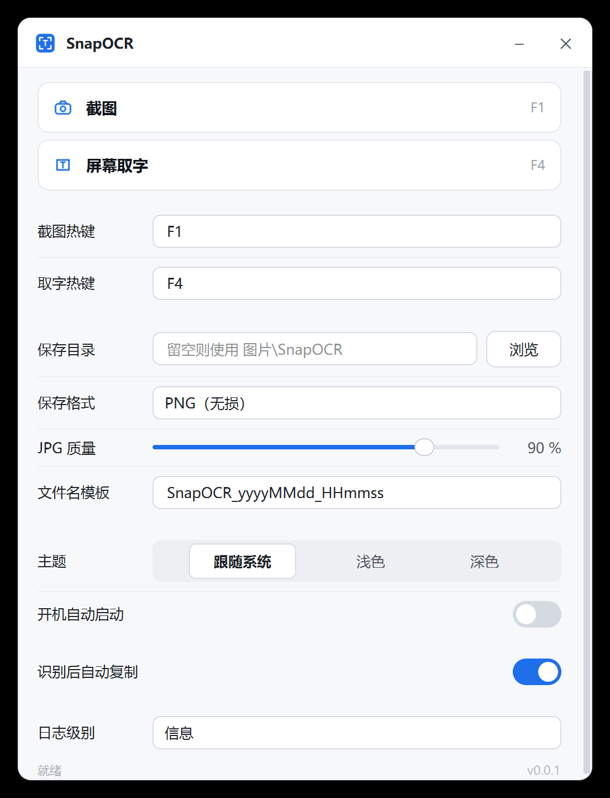
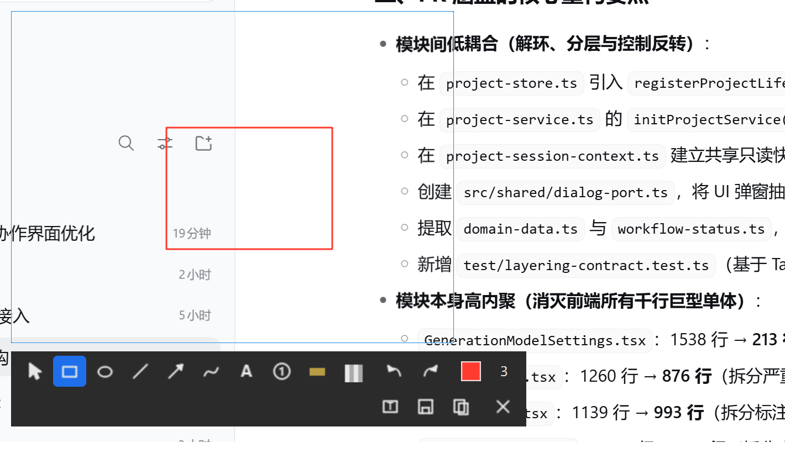
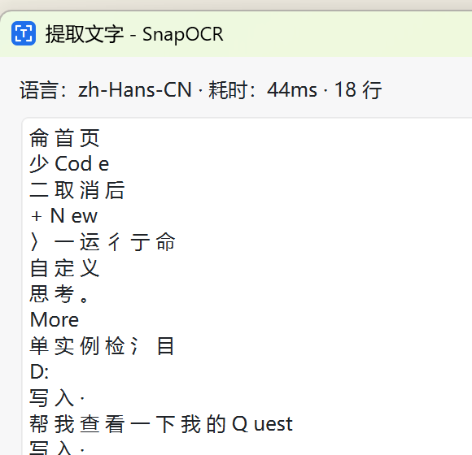

# SnapOCR

Windows 10/11 上的轻量**截图 + 标注 + OCR**工具（开发中）。

SnapOCR 的目标是“快捷、顺手、离线”：按下热键冻结屏幕、框选区域，随即画框/箭头/画笔/文字/马赛克，或一键提取图中文字，复制、保存、贴图都在悬浮工具条上完成。所有能力本地运行，默认不联网、不上传、不需要管理员权限。

[[](https://github.com/poluce/SnapOCR/actions/workflows/build.yml)

## 功能预览

| 主窗口 | 标注编辑 + 工具条 | OCR 结果窗 |
|--------|-------------------|-----------|
|  |  |  |

## 当前状态

| 阶段 | 内容 | 状态 |
|------|------|------|
| 阶段 0 | 仓库、四份文档、可编译骨架、CI | ✅ 已完成 |
| 阶段一 | 基本常用功能：截图/选区、基础标注、OCR 取字、热键/托盘/设置基础 | ✅ 已完成 |
| 阶段二 | 适当添加功能：贴图、历史、放大镜/取色、延时、长截图、高级标注 | ✅ v0.1.0（RapidOCR 延后） |
| 阶段三 | 完善阶段一/二并发布：兼容性、性能、稳定性、缺陷修复、打包/签名 | 🚧 进行中（v1.0.0-rc.1 候选版） |

任务按三阶段推进：阶段一交付基本常用功能，阶段二适当添加功能，阶段三完善前两阶段并发布（P2 大功能不纳入承诺）。

阶段三已完成：v1.0.0-rc.1 候选版发布、性能验收实测（热键→遮罩 67ms、4K 捕获 57ms、区域 OCR 91ms、空闲 28MB）、
主题一致性（浅色/深色/跟随系统）、稳定性审计与崩溃日志、发布工程
（CI 打包 + 四次 Release：v0.0.1 / v0.1.0 / v0.1.1 / v0.1.2）、英文翻译 119 条、
拖拽导出、贴图取字与再标注、需求追溯与边界回归。
剩余为需要外部环境的验证项（多显示器矩阵、真实交互点测、IM 剪贴板、干净机器）。

功能范围、验收标准与任务分解见 [需求文档](docs/01-需求文档.md)、[开发文档](docs/03-开发文档.md)，实际进度见 [完成情况](docs/04-完成情况.md)。

## 功能规划（P0 = MVP）

| 模块 | P0 能力 |
|------|---------|
| 截图 | 区域截图（`F1`）、全屏/活动窗口、冻结画面、尺寸坐标提示、多显示器与 100%–200% DPI、物理像素 1:1 |
| 标注 | 矩形、椭圆、直线、箭头、画笔、文字、序号、高亮、马赛克；选中/移动/删除；撤销重做；颜色/线宽/字号 |
| 输出 | 复制到剪贴板、保存 PNG/JPG、另存为 |
| OCR | 截图后提取文字、`F4` 屏幕框选直接取字、结果窗选择/复制、离线识别、语言包缺失提示 |
| 系统 | 全局热键（可配置、冲突检测）、托盘常驻、单实例、开机自启、设置持久化、深浅主题、本地日志 |

P1（贴图、历史、RapidOCR、放大镜、长截图…）与 P2（录屏、二维码、翻译、安装包/签名…）规划见 [需求文档](docs/01-需求文档.md)。

## 技术栈

- **语言/框架**：C++20，Qt 6.11 Widgets（Core / Gui / Widgets / Network / Concurrent / Test）
- **编译**：MSVC 19.51（VS 18）、CMake ≥ 3.21、Ninja（`/utf-8`，C++20）
- **OCR**：Windows 内置 OCR（`Windows.Media.Ocr`，C++/WinRT）优先；RapidOCR（ONNX Runtime）作为 P1 可切换引擎
- **平台能力**：Win32 `RegisterHotKey`、GDI 屏幕捕获、PerMonitorV2 DPI、`QLocalServer` 单实例
- **CI**：GitHub Actions `windows-latest` + `install-qt-action` + `ctest`（CI 固定 Qt 6.10.3，本机开发用 6.11.1）

## 环境要求

- Windows 10 1903+ / Windows 11，x64
- Qt 6.11.1 `msvc2022_64`（默认安装路径 `E:\Qt6\6.11.1\msvc2022_64`，可用 `QTDIR` 覆盖）
- Visual Studio 2022 或 2026，安装“使用 C++ 的桌面开发”工作负载
- CMake ≥ 3.21、Ninja（本机默认取 Qt 自带 `Tools/CMake_64`、`Tools/Ninja`）
- Windows SDK 10.0.26100（含 C++/WinRT 头文件）

## 下载安装（绿色版）

到 [Releases](https://github.com/poluce/SnapOCR/releases) 下载：

- **安装包**：`SnapOCR-<版本>-setup.exe`（按当前用户安装，无需管理员权限，可选桌面图标/开机自启）
- **绿色包**：`SnapOCR-<版本>-win64.zip`（解压到任意目录，双击 `SnapOCR.exe` 即可）

环境有问题时先跑诊断命令（系统/显示器/OCR 语言/运行库/热键/路径）：

```bat
SnapOCR.exe --doctor
```

绿色包用法：

- 免安装、免管理员权限、默认零联网；
- 首次启动显示主窗口（截图 / 屏幕取字 / 设置三个入口），之后常驻托盘；按 `F1` 截图、`F4` 取字；
- 设置界面：托盘菜单 → 设置，或主窗口「设置」按钮，或 `SnapOCR.exe --settings`；
- 配置与日志位置：`%APPDATA%\SnapOCR\SnapOCR.ini`、`%LOCALAPPDATA%\poluce\SnapOCR\logs`（exe 同目录放 `SnapOCR.portable` 文件可切换为便携模式）。

## 构建与运行

```bat
:: 构建 Debug + 运行单元测试/冒烟测试
scripts\build.bat

:: Release 构建（跳过测试）
scripts\build.bat Release --no-tests

:: 启动 GUI（Qt 运行库自动加入 PATH）
scripts\run.bat

:: 端到端验证（需交互式桌面，会注入键鼠）
powershell -NoProfile -ExecutionPolicy Bypass -File scripts\e2e-smoke.ps1 -BuildDir build

:: CLI 自检
build\SnapOCR.exe --version
build\SnapOCR.exe --smoke-test
ctest --test-dir build --output-on-failure
```

在 WSL 下调用 Windows 工具链：

```bash
cmd.exe /c 'cd /d D:\Document\SnapOCR && scripts\build.bat Debug'
```

## 目录结构

```text
SnapOCR/
├── cmake/                  # CMake 辅助模板（Version.h.in）
├── docs/                   # 四份文档（需求/设计/开发/完成情况）与资源
├── scripts/                # build.bat / run.bat
├── src/
│   ├── app/                # 应用控制器（命令行、装配）
│   ├── capture/            # 屏幕捕获（阶段一 M1）
│   ├── overlay/            # 逐屏覆盖层与选区（阶段一 M1）
│   ├── editor/ annotate/   # 标注编辑器与文档模型（阶段一 M2）
│   ├── ocr/                # OCR 引擎抽象与实现（阶段一 M3 / 阶段二增强）
│   ├── ui/                 # 主窗口、设置、结果窗、工具条
│   ├── platform/win32/     # 热键、DPI、剪贴板、自启等 Win32 封装
│   └── common/             # 配置、日志、几何工具
├── tests/                  # Qt Test 单元测试
├── CMakeLists.txt
└── README.md
```

## 文档

仓库开发文档统一为四份（索引见 [docs/README.md](docs/README.md)）：

| 文档 | 说明 |
|------|------|
| [需求文档](docs/01-需求文档.md) | 产品定位、场景、需求编号（F-xx/N-xx）、快捷键、非功能需求、验收标准 |
| [设计文档](docs/02-设计文档.md) | 架构、捕获/覆盖层/标注/OCR/系统集成方案、技术选型（附录 ADR） |
| [开发文档](docs/03-开发文档.md) | 环境、构建/运行/打包/CI、开发规范、阶段 0/一/二/三任务分解 |
| [完成情况](docs/04-完成情况.md) | 里程碑状态、已完成内容与验收证据、需求实现状态、未完成工作 |

## 许可

当前为私有开发阶段，暂未添加开源许可证。后续若开源，建议使用 MIT（第三方依赖许可证见[设计文档](docs/02-设计文档.md)）。Qt 采用 LGPLv3/GPLv3 双许可，分发闭源程序需遵守 LGPLv3（动态链接、声明与可替换方式）。
