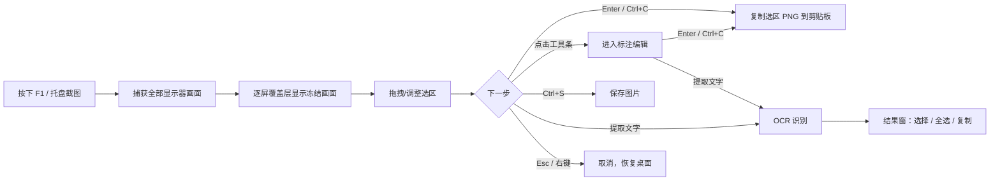

# 产品需求文档（PRD）

> 状态：M0 定稿（2026-10-23），M1 起按本文件验收。
> 变更规则：需求增删改先更新本文件与 `PLAN.md` 范围表，再进入实现。

## 1. 背景与目标

截图与“从屏幕取字”是高频操作：办公文档、网页资料、视频字幕、报错信息、扫描件中的文字常常无法直接复制。现有工具要么功能重（录制/云分享/账号），要么 OCR 依赖联网，要么标注流程不够顺手。

**SnapOCR 目标**：Windows 上轻量、离线、即截即用的截图 + 标注 + OCR 工具。

可衡量的目标（MVP）：

1. 热键唤起到覆盖层出现 **≤ 80ms**；
2. 截图 → 标注 → 复制到剪贴板，全程 **≤ 10s**（熟练用户 3s）；
3. 截图 → 取字 → 文本进剪贴板，**≤ 3s**（常规区域）；
4. 免安装、免管理员权限、离线可用；
5. 自用可替代现有截图工具，核心路径零崩溃。

## 2. 目标用户与场景

**目标用户**：频繁截屏的办公人员、产品/设计/开发、客服与教师、学生；环境多为 Win10/11，单屏或多屏，100%–200% 缩放，部分为无外网的内网环境。

| 场景 | 描述 | 期望结果 |
|------|------|----------|
| S1 快速分享 | 截取网页/应用区域，用箭头/框标出重点，粘贴到 IM | `F1` → 框选 → 标注 → `Ctrl+C`，剪贴板得到 PNG |
| S2 屏幕取字 | 视频字幕、图片、扫描件、不可复制的文档里的文字 | `F4` → 框选 → 文本进入剪贴板（或结果窗选择后复制） |
| S3 存档 | 截取窗口/区域，命名保存归档 | `Ctrl+S` 按模板命名保存到配置目录 |
| S4 对照 | 把截图钉在屏幕上层，边看边操作（P1） | 工具条“贴图”，置顶悬浮，`Esc` 关闭 |
| S5 失败排查 | 截取报错信息，标注后发群里 | 标注 + 复制；可选用 OCR 提取报错文本 |

## 3. 竞品与差异

| 产品 | 优势 | 不足 / 我们的空间 |
|------|------|-------------------|
| Snipaste | 贴图、取色、交互标杆；专业版已支持 OCR | 免费版无 OCR；部分高级能力收费 |
| PixPin | 长截图、贴图、OCR、录制齐全 | 功能多、体积与学习成本更高 |
| QQ/微信截图 | 门槛低、人人可用 | 标注/OCR 能力基础，依赖 IM |
| ShareX | 功能极强、可编排 | 界面复杂、偏英文/极客，非“即截即用” |
| Windows 截图工具 | 系统自带、Snipping 基础 | 标注/OCR/贴图能力有限 |

**差异定位**：原生 C++/Qt、轻量绿色、**离线 OCR 一体**、Snipaste 式顺手工具条、中文界面、无广告无账号。

## 4. 术语

| 术语 | 含义 |
|------|------|
| 选区 | 用户在冻结画面上框出的矩形区域 |
| 覆盖层 | 截图时覆盖各显示器的无边框置顶窗口，显示冻结画面与选区 |
| 冻结画面 | 截图瞬间捕获的屏幕像素快照 |
| 图元（Annotation） | 标注对象：矩形、箭头、文字、画笔轨迹等 |
| 工具条 | 选区确认后出现的悬浮操作条（标注工具/复制/保存/取字） |
| 屏取字 | 不进入编辑器，直接框选屏幕区域做 OCR |
| 物理像素 | 显示器实际像素坐标（导出与 OCR 的基准坐标） |
| 逻辑像素 | Qt 经 DPI 缩放后的设备无关坐标（仅 UI 使用） |

## 5. 用户流程

### 5.1 主流程（截图 → 标注 → 输出）



### 5.2 屏取字流程（`F4`）

```text
F4 → 冻结屏幕 → 框选 → 松开鼠标即 OCR → 结果窗（或自动复制后关闭）
     → 识别失败/语言包缺失：中文提示 + 安装引导
```

### 5.3 交互规则

- 工具条默认出现在选区下方（空间不足时移到上方/内部），不遮挡选区内容。
- 选区确认后进入标注编辑态；`Esc` 逐级退出（编辑 → 取消截图）。
- 单击已选图元可选中并拖动；`Delete` 删除；工具栏切换工具不丢失已有图元。
- 所有核心操作可纯键盘完成（见快捷键表）；鼠标操作均有即时视觉反馈。
- 默认“完成”动作可配置：复制到剪贴板（默认）/ 保存 / 复制并关闭。

## 6. 功能需求

优先级：**P0** = MVP 必须；**P1** = 体验增强；**P2** = 后续版本。

### 6.1 截图（F-CAP）

| 编号 | 需求 | 优先级 | 验收要点 |
|------|------|--------|----------|
| F-CAP-01 | `F1` 全局热键触发区域截图（可配置） | P0 | 任意前台应用下按 `F1` 均能唤起；可在设置中改键 |
| F-CAP-02 | 全屏截图（全部显示器 / 指定显示器） | P0 | 托盘菜单与工具条可触发；输出尺寸等于对应显示区域物理像素 |
| F-CAP-03 | 活动窗口截图 | P0 | 捕获当前前台窗口外接矩形（含阴影可裁掉），不越界 |
| F-CAP-04 | 冻结画面 + 选区外暗化 | P0 | 覆盖层显示截图瞬间画面；暗化遮罩透明度适中，选区内容无遮挡 |
| F-CAP-05 | 选区拖拽、8 向控制点缩放、方向键微调 | P0 | 边界吸附准确；方向键 1px、`Shift+方向键` 10px（物理像素） |
| F-CAP-06 | 选区尺寸/坐标提示 | P0 | 实时显示物理像素宽高与左上角坐标 |
| F-CAP-07 | `Enter`/双击确认，`Esc`/右键取消 | P0 | 取消后不残留窗口/遮罩/托盘图标异常 |
| F-CAP-08 | 多显示器（含负坐标、不同排列）与 100%–200% 混合 DPI | P0 | 每块屏截取、跨屏框选、导出坐标均正确；手测矩阵全过 |
| F-CAP-09 | 捕获时排除 SnapOCR 自身窗口 | P0 | 自身主窗/覆盖层不出现在截图中 |
| F-CAP-10 | 输出物理像素 1:1 | P0 | 4K/150% 缩放下截图尺寸与内容不缩放、不模糊 |
| F-CAP-11 | 重新调整选区（裁剪） | P0 | 确认前可拖动/缩放选区；确认后进入编辑可继续调整边界 |
| F-CAP-12 | 捕获鼠标光标（可选开关） | P1 | 默认关闭；开启后光标绘制在正确位置 |
| F-CAP-13 | 延时截图（可配置 1–10s） | P1 | 倒计时提示；到时后按冻结画面流程执行 |
| F-CAP-14 | 放大镜 + 像素取色 | P1 | 选区角附近显示放大像素与 RGB/HEX，可复制色值 |
| F-CAP-15 | 窗口/控件智能识别 | P1 | 鼠标悬停时高亮窗口/控件边界，单击直接选中 |
| F-CAP-16 | 滚动长截图 | P1 | 窗口滚动拼接，重叠区域自动对齐；失败给出提示 |
| F-CAP-17 | 截图历史 | P1 | 最近 50 张缩略图；可重开编辑、复制、删除、清理 |

### 6.2 标注编辑（F-ANN）

| 编号 | 需求 | 优先级 | 验收要点 |
|------|------|--------|----------|
| F-ANN-01 | 矩形标注 | P0 | 拖拽绘制，可设颜色/线宽；边界清晰 |
| F-ANN-02 | 椭圆标注 | P0 | 同上，支持拖拽成圆/椭圆 |
| F-ANN-03 | 直线标注 | P0 | 两点绘制，可设颜色/线宽 |
| F-ANN-04 | 箭头标注 | P0 | 起点/终点拖拽，箭头方向与端点一致 |
| F-ANN-05 | 自由画笔 | P0 | 连续轨迹，平滑无断裂；可设颜色/线宽 |
| F-ANN-06 | 文字标注 | P0 | 点击输入框输入中文/英文；可设字号/颜色；支持换行 |
| F-ANN-07 | 序号标注（步骤 1/2/3…） | P0 | 点击生成递增序号；可重置/继续递增 |
| F-ANN-08 | 高亮标注 | P0 | 半透明矩形覆盖，不遮挡原文字可读性 |
| F-ANN-09 | 马赛克（像素化） | P0 | 拖拽区域像素化，块大小可调；覆盖隐私信息有效 |
| F-ANN-10 | 图元选中、移动、删除 | P0 | 单击命中选中（含旋转箭头包围盒），拖动移动；`Delete` 删除 |
| F-ANN-11 | 撤销 / 重做 | P0 | `Ctrl+Z`/`Ctrl+Y`，≥50 步；撤销后重做栈行为正确 |
| F-ANN-12 | 颜色、线宽、字号设置 | P0 | 预设色板 + 自定义；设置对后续图元生效；可改选中图元 |
| F-ANN-13 | 复制到剪贴板 | P0 | `Enter`/`Ctrl+C`；剪贴板格式为 PNG（DIB/PNG 兼容主流 IM） |
| F-ANN-14 | 保存 PNG/JPG、另存为 | P0 | `Ctrl+S` 按模板保存；JPG 质量可配；另存可选目录 |
| F-ANN-15 | 编辑画布与原图 1:1 | P0 | 图元在导出图像像素坐标绘制，无 DPR 二次缩放 |
| F-ANN-16 | 高斯模糊笔刷 | P1 | 与马赛克同流程，半径可调 |
| F-ANN-17 | 图元缩放控制点 / 图层顺序 | P1 | 选中后可缩放；上移/下移一层 |
| F-ANN-18 | 形状样式（填充/描边/虚线） | P1 | 至少支持描边/填充切换 |
| F-ANN-19 | 贴图 | P1 | 从截图/剪贴板生成置顶窗口；拖拽移动、滚轮缩放、透明度/旋转、`Esc` 关闭 |
| F-ANN-20 | 一键复制并贴图 | P1 | 复制后自动贴到屏幕（可配置） |

### 6.3 OCR（F-OCR）

| 编号 | 需求 | 优先级 | 验收要点 |
|------|------|--------|----------|
| F-OCR-01 | 截图后工具条“提取文字” | P0 | 点击后对当前选区内容识别，结果显示在结果窗 |
| F-OCR-02 | `F4` 屏幕框选直接取字 | P0 | 松开鼠标即识别；默认复制到剪贴板并提示（可在设置改） |
| F-OCR-03 | OCR 结果窗 | P0 | 按行展示文本；支持全选、选择部分、复制；显示识别语言与耗时 |
| F-OCR-04 | 识别语言跟随系统 | P0 | 读取系统可用 OCR 语言；当前环境实测 `zh-Hans-CN` |
| F-OCR-05 | 自动复制开关 | P0 | 开启时识别完成自动写入剪贴板（默认开启） |
| F-OCR-06 | 语言包缺失提示 | P0 | 无可用 OCR 语言时给中文说明与 Windows 设置安装入口，不崩溃 |
| F-OCR-07 | 离线识别与耗时提示 | P0 | 无网络可识别；界面显示识别中状态与耗时 |
| F-OCR-08 | 段落合并 / 清理排版 | P1 | 可将多行合并为段落、去除 OCR 多余空格 |
| F-OCR-09 | 识别失败重试/裁边 | P1 | 失败或效果差时提示重选区域 |
| F-OCR-10 | RapidOCR 引擎切换与基准 | P1 | 设置中切换引擎；基准集字符召回 ≥ 85%，中文准确率优于 Windows OCR |
| F-OCR-11 | 表格/代码区域识别增强 | P2 | 表格结构尽量保序；代码缩进尽量保留 |
| F-OCR-12 | 翻译识别结果 | P2 | 引擎可插拔；默认关闭且需用户显式开启 |
| F-OCR-13 | 二维码/条码识别 | P2 | 识别结果可复制 |

### 6.4 系统集成（F-SYS）

| 编号 | 需求 | 优先级 | 验收要点 |
|------|------|--------|----------|
| F-SYS-01 | 全局热键可配置 + 冲突检测 | P0 | 设置页录制新键；冲突时提示并保留旧键 |
| F-SYS-02 | 托盘常驻与菜单 | P0 | 托盘图标可右键：截图/取字/设置/退出；单击可触发截图（可配） |
| F-SYS-03 | 单实例 | P0 | 重复启动不产生第二个进程；第二次启动唤起已有实例 |
| F-SYS-04 | 设置持久化 | P0 | 修改后重启保留；损坏配置可回退默认并提示 |
| F-SYS-05 | 开机自启 | P0 | HKCU Run 写入/删除；任务管理器可禁用 |
| F-SYS-06 | 主题（浅色/深色/跟随系统） | P0 | 切换即时生效；覆盖层/工具条/结果窗一致 |
| F-SYS-07 | 保存目录 / 格式 / 文件名模板 | P0 | 模板支持时间变量；目录不存在时自动创建；路径非法时提示 |
| F-SYS-08 | 本地日志与错误提示 | P0 | 日志位于 `%LOCALAPPDATA%\SnapOCR\logs`，5MB×3 轮转；崩溃/异常有中文提示 |
| F-SYS-09 | 简体中文 UI | P0 | 全部面向用户文本中文；代码预留 `tr()` |
| F-SYS-10 | 完全离线、无遥测 | P0 | 默认不发任何网络请求；无账号体系 |
| F-SYS-11 | 便携模式 | P1 | exe 同目录存在 `SnapOCR.portable` 时配置/日志写同目录 |
| F-SYS-12 | 拖拽保存 | P1 | 从结果/贴图拖到资源管理器可保存 |
| F-SYS-13 | 英文 UI / i18n | P2 | Qt `.ts` 机制；语言可切换 |
| F-SYS-14 | CLI 截图/OCR | P2 | 参数化截图与识别，供脚本调用 |
| F-SYS-15 | 安装包 / 代码签名 / 自动更新 | P2 | Inno Setup 安装/卸载；签名；可选更新检查（默认关闭） |
| F-SYS-16 | 云分享/上传 | P2 | 默认关闭；开启需显式授权，单独设计隐私说明 |

## 7. 快捷键（默认，均可配置）

| 操作 | 默认按键 | 阶段 |
|------|----------|------|
| 区域截图 | `F1` | P0 |
| 屏幕取字 | `F4` | P0 |
| 取消 / 退出当前流程 | `Esc` / 右键 | P0 |
| 确认选区（进入编辑） | `Enter` / 双击 | P0 |
| 复制到剪贴板 | `Enter` / `Ctrl+C` | P0 |
| 保存（按模板） | `Ctrl+S` | P0 |
| 另存为 | `Ctrl+Shift+S` | P0 |
| 撤销 / 重做 | `Ctrl+Z` / `Ctrl+Y` | P0 |
| 删除选中图元 | `Delete` / `Backspace` | P0 |
| 微调选区 | 方向键 1px / `Shift+方向键` 10px | P0 |
| 工具切换（矩形/椭圆/箭头/画笔/文字/序号/高亮/马赛克） | `1`–`8`（M2 定稿） | P1 |
| 贴图 | `F3`（可配置） | P1 |
| 全屏截图（全部屏） | `Ctrl+F1`（可配置） | P1 |

> 热键注册失败（被其他软件占用）时必须提示用户改键，不得静默失效。

## 8. 非功能需求

| 编号 | 类别 | 要求 |
|------|------|------|
| N-PERF-01 | 性能 | 热键→覆盖层可见 ≤ 80ms（目标），≤ 150ms（可接受） |
| N-PERF-02 | 性能 | 托盘空闲内存 ≤ 120MB；4K 双屏截图峰值 ≤ 500MB |
| N-PERF-03 | 性能 | 4K 区域（约 1/4 屏）Windows OCR 端到端 ≤ 1s |
| N-PERF-04 | 性能 | 冷启动 ≤ 800ms（托盘常驻后热键响应不计冷启动） |
| N-COMPAT-01 | 兼容 | Windows 10 1903+、Windows 11；x64；不支持 Win7/8/ARM |
| N-COMPAT-02 | 兼容 | 100%/125%/150%/200% DPI；混合 DPI 多屏 |
| N-COMPAT-03 | 兼容 | 1–4 块显示器，任意相对排列（含负坐标、主屏不在左上） |
| N-SEC-01 | 安全/隐私 | 无需管理员权限；默认零联网；OCR 与图像处理全本地 |
| N-UX-01 | 可用性 | 所有核心操作可键盘完成；`Esc` 可退出任意流程 |
| N-UX-02 | 可用性 | 异常场景给中文提示，不静默失败，不崩溃 |
| N-MAINT-01 | 可维护 | 核心逻辑单元测试覆盖；CI（构建 + 测试）必须通过 |
| N-SIZE-01 | 体积 | 主程序（不含模型）≤ 15MB；含 RapidOCR 模型 ≤ 40MB |
| N-REL-01 | 交付 | 语义化版本；CI 产物可复现；发布包含版本说明 |

## 9. 异常与边界

| 场景 | 期望行为 |
|------|----------|
| 多屏 DPI 不同 / 屏幕旋转 | 选区、覆盖层、OCR、导出均按物理像素正确；必要时逐屏手动验证 |
| 热键被占用 | 注册失败提示 + 引导改键；保留原配置 |
| 无可用 OCR 语言包 | 结果窗/提示框说明如何安装语言包；不崩溃；P1 可用 RapidOCR 兜底 |
| OCR 引擎异常/超时 | 提示失败原因；可重试；不卡主线程 |
| 超大图（超 OcrEngine.MaxImageDimension） | 切片识别再合并；显示提示 |
| 剪贴板被占用 | 重试有限次数后提示“复制失败” |
| 保存失败（权限/磁盘满/路径非法） | 中文错误提示 + 日志；不丢当前编辑内容 |
| 全屏独占游戏 / DRM 受保护内容 | 捕获为黑屏或失败时提示“当前画面不支持捕获” |
| 屏幕分辨率/缩放运行中变化 | 重新枚举显示器；覆盖层重建后选区坐标正确 |
| 第二次启动 | 唤起已有实例，不创建新进程 |
| 配置损坏 | 回退默认配置并记录日志 |
| 便携目录不可写 | 回退到 `%APPDATA%` 并提示 |

## 10. MVP 验收标准（M1–M4 完成后逐项勾选）

### 最小闭环（任何版本不得退化）

1. 任意前台应用按 `F1` → 框选 → `Enter`，剪贴板得到清晰 PNG，可直接粘贴进 QQ/微信/Word；
2. `Ctrl+S` 按模板保存 PNG/JPG，文件可正常打开；
3. `Esc` 取消后桌面无残留，可连续截图 10 次不卡顿。

以下为完整 MVP 验收清单：

- [ ] `F1` 在任意前台应用中唤起截图，覆盖层出现 ≤ 150ms，`Esc` 无残留；
- [ ] 单屏 100%/150%/200% 与双屏混合 DPI 场景截图/导出均正确；
- [ ] 9 类标注工具可用，撤销/重做 ≥ 50 步，导出 1:1 像素；
- [ ] `Enter`/`Ctrl+C` 复制后粘贴到 QQ/微信/Word 图片正常；
- [ ] `Ctrl+S` 按模板保存 PNG/JPG 成功，路径可配置；
- [ ] `F4` 取字：中文印刷体 300 字以内段落，识别结果可直接复制使用；
- [ ] OCR 语言缺失、识别失败有中文提示，不崩溃；
- [ ] 托盘常驻、单实例、开机自启、设置持久化验证通过；
- [ ] 真实 `windows` 平台 `--smoke-test` 与 CI 全绿；
- [ ] 托盘空闲内存 ≤ 120MB，热键→遮罩 ≤ 80ms（目标）/150ms（可接受）。

## 11. 待定问题

| 问题 | 当前默认 | 决策阶段 |
|------|----------|----------|
| 开源许可证 | 私有开发，暂不加；开源建议 MIT | 发布前 |
| 是否支持 Win10 32 位 / ARM64 | 否，仅 x64 | MVP 前确认 |
| OCR 默认是否自动复制 | 是 | M3 |
| RapidOCR 模型是否内置 | P1 内置（约 15MB），按需下载作为备选 | M5 |
| 默认保存目录 | `图片\SnapOCR` | M2 |
| 英文 UI | P2，先用中文 | 发布前 |
| 遥测/更新检查 | 无遥测；更新检查默认关闭 | 发布前 |

## 12. 参考

- [Windows.Media.Ocr（Microsoft Learn）](https://learn.microsoft.com/en-us/uwp/api/windows.media.ocr.ocrengine)
- [RapidOCR（GitHub）](https://github.com/RapidAI/RapidOCR)
- [Snipaste 下载与版本历史](https://zh.snipaste.com/download.html)
- [Qt 6 高 DPI 文档](https://doc.qt.io/qt-6/highdpi.html)
- [Windows DPI 感知（Microsoft Learn）](https://learn.microsoft.com/en-us/windows/win32/hidpi/high-dpi-desktop-application-development-on-windows)
