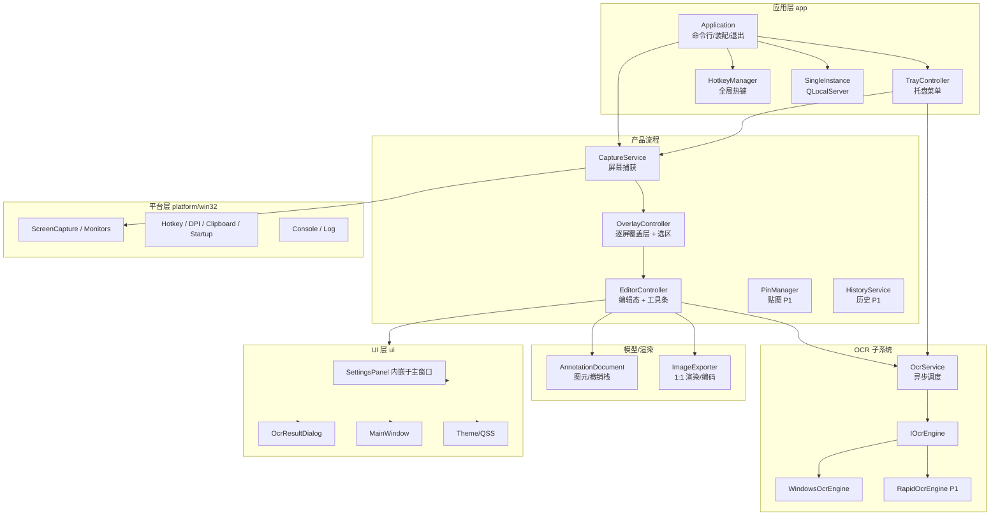
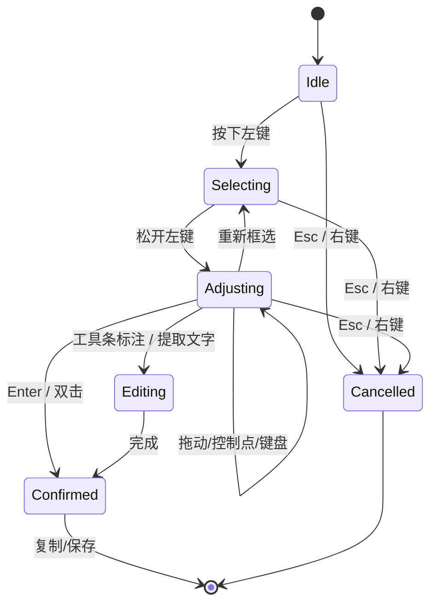

# 设计文档

> 状态：阶段 0 定稿（2026-10-23）。阶段一起按本文件实现；契约变更必须先改本文件（重大决策记录于 §17）。
> 关联：[需求文档](01-需求文档.md) · [开发文档](03-开发文档.md) · [完成情况](04-完成情况.md)

## 1. 约束与已验证环境

目标平台：Windows 10 1903+ / Windows 11，x64，**PerMonitorV2 DPI 感知**，无管理员权限。

| 组件 | 版本 | 说明 |
|------|------|------|
| C++ | C++20 | `/utf-8`，中文直写源码 |
| Qt | 6.11.1 `msvc2022_64` | Widgets / Core / Gui / Network / Concurrent / Test |
| MSVC | 19.51（VS 18 Community，v145 工具集） | 已实测与 Qt 6.11.1 msvc2022 库编译/链接/运行正常 |
| CMake | 3.30.5（Qt Tools） | 因 CMake 3.30 无 VS18 生成器，统一使用 **Ninja** |
| Ninja | 1.12.1 | 单配置构建 |
| Windows SDK | 10.0.26100 | 含 C++/WinRT 头文件 |
| OCR | Windows OCR，`zh-Hans-CN` 已安装 | 实测识别 1 张中文界面截图耗时 59ms，准确率一般 |

M0 验证结果：`scripts\build.bat Debug` 构建通过；`ctest` 2/2；`SnapOCR.exe --smoke-test` 在真实 `windows` 平台返回 0。

### 1.1 已确认技术决策（摘要）

| 决策项 | 结论 |
|--------|------|
| 技术栈 | C++20 + Qt 6.11.1 Widgets + MSVC 19.51（VS 18）+ CMake/Ninja |
| 仓库与交付 | `D:\Document\SnapOCR`；GitHub 私有 `poluce/SnapOCR`；CI `windows-latest` |
| 屏幕捕获 | Win32 GDI 逐屏 `BitBlt`（不使用 `QScreen::grabWindow`） |
| 覆盖层 | 每屏一个置顶无边框窗口 + 全局选区模型（混合 DPI 不失真） |
| 标注编辑 | QWidget + QPainter；`AnnotationDocument` + 快照式 `QUndoStack` |
| OCR | `Windows.Media.Ocr` 优先；`IOcrEngine` 抽象预留 RapidOCR（P1） |
| 交互与范围 | Snipaste 式悬浮工具条；默认 `F1` 截图、`F4` 取字 |
| 打包与 CI | `windeployqt` 绿色 zip（安装包 P2）；CI Qt 6.10.3（aqt 兼容），本机 6.11.1 |
| 文档体系 | 四份：需求 / 设计 / 开发 / 完成情况 |

> 交付阶段：阶段一 = 基本常用功能（内部里程碑 M1–M4）；阶段二 = 适当添加功能（M5 增强部分）；阶段三 = 完善前两阶段并发布。
> 需求与阶段的逐条映射见 [需求文档 §6.0.1](01-需求文档.md)；本文档中的 M1–M5 是内部工程里程碑。

> 详细备选方案、取舍与后果见 §17 附录（原 ADR-0001）。

## 2. 架构总览



### 依赖规则（硬约束）

1. `annotate` / `ocr` / `capture` 的**核心模型**不依赖具体窗口类，便于单测。
2. **UI 不得直接调用 Win32 热键/捕获 API**；经 `platform/win32` 封装与 `CaptureService`。
3. OCR 引擎由 `IOcrEngine` 抽象；业务层不得直接 `#include <winrt/...>`。
4. 平台层不得依赖 `editor/overlay` 等产品流程（只提供能力）。
5. 所有跨模块通信使用值类型（`CaptureResult`、`AnnotationDocument`、`OcrResult`）或信号，不传裸句柄。

### 目标目录（M1–M5 逐步落地）

| 路径 | 职责 | 阶段 |
|------|------|------|
| `src/main.cpp` | 入口：挂接控制台、QApplication、装配 | M0 ✅ |
| `src/app/Application.*` | 命令行解析、主窗口/托盘装配、生命周期 | M0 ✅ / M4 扩展 |
| `src/app/TrayController.*` | 托盘图标与菜单 | M4 |
| `src/app/HotkeyManager.*` | 全局热键注册、冲突检测、WM_HOTKEY 分发 | M1 |
| `src/app/SingleInstance.*` | QLocalServer/QLocalSocket 单实例与命令转发 | M4 |
| `src/capture/*` | `MonitorLayout`、`CaptureService`、`CaptureResult` | M1 |
| `src/overlay/*` | `OverlayWindow`（每屏）、`SelectionController`、`OverlayToolbar` | M1 |
| `src/editor/*` | `EditorWindow`、`AnnotationCanvas`、`ToolController` | M2 |
| `src/annotate/*` | `AnnotationDocument`、图元、撤销命令、命中测试、渲染 | M2 |
| `src/ocr/*` | `IOcrEngine`、`WindowsOcrEngine`、`OcrService`、`OcrResult` | M3 / P1 |
| `src/ui/*` | 设置、OCR 结果窗、历史、贴图、主题 | M2–M4 |
| `src/platform/win32/*` | 捕获、热键、DPI、剪贴板、自启、控制台 | M1–M4 |
| `src/common/*` | 设置 schema、日志、几何工具、版本 | M1–M4 |
| `tests/*` | Qt Test 单测、黄金图像 | 持续 |
| `tools/*` | 一次性诊断工具（OCR 探针等） | 按需 |

## 3. 线程模型

| 线程 | 职责 | 禁止 |
|------|------|------|
| UI 线程 | Qt 窗口、事件、选区交互、标注渲染 | 阻塞式捕获/OCR（>16ms 的操作必须异步） |
| 捕获线程 | GDI `BitBlt` 多屏捕获（可复用线程池） | 触碰 QWidget；只在完成后回投结果 |
| OCR worker | WinRT 调用、图像转换、结果组装 | 直接改 UI；直接回调业务状态 |
| 日志线程/异步 | 文件写入可异步批量 | — |

规则：

- 捕获在热键触发后立即进入，目标 80ms 内完成（4K 双屏约 66MB 内存拷贝，需优化 DIB 方式）。
- OCR 通过 `OcrService` 暴露异步 API（信号/Signal 或 `QFutureWatcher`），结果回 UI 线程。
- WinRT 异步调用在 worker 线程内用阻塞等待；worker 内先 `winrt::init_apartment(apartment_type::multi_threaded)`。
- 所有资源释放（GDI 对象、HWND、HANDLE）使用 RAII 封装，禁止泄漏。

## 4. 坐标系统与 DPI

**唯一权威坐标系：物理像素 + 虚拟桌面原点**（左上可为负）。UI 层使用 Qt 逻辑坐标，仅在边界处换算。

```cpp
// 物理坐标（权威）：覆盖全部显示器，主屏左上角不一定是 (0,0)
struct PhysicalRect { int x; int y; int width; int height; };
```

换算规则：

- 每块屏 `MonitorInfo.physicalGeometry`（物理像素）与 `devicePixelRatio`（Qt 逻辑/物理比例）一一对应；
- Qt 逻辑坐标 → 物理：`physical = screen.physicalOrigin + (logical - screen.logicalOrigin) * dpr`（逐屏计算，禁止全桌面统一系数）；
- 选区、图元、OCR 结果、导出全部使用物理坐标；工具条、光标提示等 UI 才用逻辑坐标；
- 屏幕旋转：按 `DEVMODE.dmDisplayOrientation` 处理，捕获图先旋转到视觉正向再进入流程；
- 显示器热插拔/分辨率变化：重新枚举并重建覆盖层，正在进行的截图直接取消并提示。

**手测矩阵**（M1 出口）：单屏 100/125/150/200%；双屏同 DPI；双屏混合 DPI；主屏在右/下方（负坐标）；旋转屏（若条件允许）；RDP 环境。

## 5. 屏幕捕获（CaptureService）

### 5.1 方案

**M1 采用 Win32 GDI 逐显示器捕获**（不用 `QScreen::grabWindow`，避免 DPR 二次缩放导致模糊/错位）：

1. `EnumDisplayMonitors` + `GetMonitorInfoW` 枚举显示器与物理矩形；
2. 每块屏 `GetDC(NULL)` / `CreateCompatibleDC` / `CreateDIBSection`（32bpp）→ `BitBlt(SRCCOPY | CAPTUREBLT)`；
3. DIB 内存 → `QImage`（`Format_RGB32` 或 `ARGB32`，注意扫描行方向与 stride）；
4. 记录 `CaptureResult{ screens[], virtualGeometry, capturedAtMs }`；
5. 可选绘制鼠标光标（`GetCursorInfo` + `DrawIconEx`，P1）。

### 5.2 关键点

- `CAPTUREBLT` 用于捕获分层窗口（部分场景），代价略高；
- 覆盖层创建前完成全部捕获，避免把自己截进去（F-CAP-09）；
- 独占全屏 DirectX / DRM 受保护内容可能返回黑屏：检测纯黑 + 提示“当前画面不支持捕获”，不崩溃；
- GDI 捕获失败（句柄/内存）→ 返回错误码与中文提示；
- 4K×2 屏 ≈ 66MB `QImage` 内存，捕获后按屏保留，超时或取消立即释放；
- 后续若需更高帧率/更高兼容性，可替换为 DXGI Desktop Duplication（ADR 记录触发条件）。

### 5.3 对外接口（M1 定稿）

```cpp
namespace snapocr::capture {

struct MonitorInfo {
    QString id;
    bool primary = false;
    QRect physicalGeometry;   // 物理像素
    qreal devicePixelRatio = 1.0;
    int rotationDegrees = 0;
};

struct ScreenFrame {
    MonitorInfo monitor;
    QImage image;             // 物理像素，Format_RGB32
};

struct CaptureResult {
    QVector<ScreenFrame> screens;
    QRect virtualGeometry;    // 物理像素并集
    qint64 capturedAtMs = 0;
};

class CaptureService final : public QObject
{
    Q_OBJECT
public:
    void captureAllScreens();          // 异步；结果经信号返回
signals:
    void captured(const CaptureResult& result);
    void failed(const QString& message);
};

}  // namespace snapocr::capture
```

## 6. 覆盖层与选区（Overlay）

### 6.1 结构

- **每块显示器一个无边框置顶覆盖窗口**（`Qt::FramelessWindowHint | Qt::WindowStaysOnTopHint | Qt::Tool`），
  显示该屏冻结画面；单屏时即一个窗口。理由：混合 DPI 下避免跨屏单窗口被某一 DPR 整体缩放。
- `OverlayController` 持有全部覆盖窗口 + 单一 `SelectionModel`（逻辑坐标/物理坐标双记录）。
- 覆盖窗口打开时：
  - 全屏显示冻结图（不缩放，按 1:1 设备像素绘制）；
  - 选区外绘制半透明暗化遮罩；
  - 选区边框、8 个控制点、尺寸/坐标 HUD；
  - 光标改为十字；捕获鼠标后拖拽跨屏仍由起始窗口收到事件，坐标经全局换算。
- 打开时隐藏 SnapOCR 其他可见窗口（托盘气泡等），退出时恢复。
- 关闭顺序：先销毁窗口再释放图片，保证无残留（F-CAP-07）。

### 6.2 交互状态机



### 6.3 工具条

- 独立置顶小窗（不放在覆盖窗口内），定位在选区下方/上方，避免超出屏幕；
- 按钮：标注工具（M2）、撤销/重做（M2）、OCR 取字、保存、复制、贴图（P1）、取消；
- 工具条自身不参与截图（截图已完成）；主题跟随应用设置。

### 6.4 性能

- 覆盖窗口绘制用 `QPainter` 直接贴图 + 遮罩区域裁切，避免全屏 QPixmap 缩放；
- 鼠标移动时只重绘受影响区域（`update(rect)`），保持 60fps 手感；
- 目标：热键按下 → 首屏覆盖可见 ≤ 80ms（4K 双屏捕获约 20–40ms + 窗口创建）。

## 7. 标注文档与编辑器（M2）

### 7.1 数据模型

```cpp
namespace snapocr::annotate {

enum class AnnotationKind {
    Rectangle, Ellipse, Line, Arrow, Freehand, Text, StepNumber, Highlight, Mosaic
};

struct AnnotationStyle {
    QColor color = Qt::red;
    int width = 3;          // 描边宽度（物理像素）
    int fontSize = 20;      // 文字字号（物理像素）
    bool filled = false;
};

struct AnnotationItem {
    AnnotationKind kind = AnnotationKind::Rectangle;
    AnnotationStyle style;
    QVector<QPointF> points;  // 物理像素；矩形=对角两点，画笔=轨迹
    QRectF bounds;            // 包围盒（缓存，便于命中测试）
    QString text;             // Text 内容
    int stepNumber = 0;       // StepNumber
    int mosaicBlockSize = 12; // Mosaic 像素块
};

class AnnotationDocument
{
public:
    void setBaseImage(QImage image);          // 原图（物理像素）
    const QImage& baseImage() const;
    const QVector<AnnotationItem>& items() const;

    void addItem(AnnotationItem item);
    void removeItem(int index);
    void replaceItems(QVector<AnnotationItem> items); // 撤销快照恢复
    int hitTest(const QPointF& physicalPos) const;    // -1 = 未命中

    QImage render() const;                    // 底图 + 图元，1:1 输出
};

}  // namespace snapocr::annotate
```

撤销/重做：M2 采用**快照式**命令（每条命令保存前后 `QVector<AnnotationItem>` 快照）。
图元数量少（通常 <100），快照内存可接受（每项 <200B），正确性优先；性能不足再改增量命令。
`QUndoStack` 上限 200 步。

### 7.2 渲染与导出

- 图元坐标即物理像素，`AnnotationCanvas` 控件按 `devicePixelRatio` 渲染：控件逻辑尺寸 × DPR = 原图像素尺寸；
- 导出直接 `AnnotationDocument::render()` → `QImage`（物理像素），**不经过控件截图**，保证 1:1；
- 马赛克：对底图相应区域做块平均/像素化后绘制，不修改原图；
- 文字：QPainter 绘制，字体按物理像素设置；M2 先支持单行/多行文本框；
- 箭头/直线：`QPainterPath` + 箭头三角计算；
- 高亮：半透明矩形（`CompositionMode_SourceOver`，透明度约 25%）；
- 导出编码：PNG（默认，无损）/JPG（质量可配 80–95）。

### 7.3 工具与编辑状态

- `ToolController` 管理当前工具（选择/矩形/…）；工具实现为轻量策略类，统一 `mousePress/Move/Release` 接口；
- 选择工具：命中测试 + 拖动移动 + 删除；M2 不做旋转/缩放控制点（P1）；
- 文字输入：覆盖在画布上的 `QTextEdit` 子控件（无边框、透明背景），失焦/`Ctrl+Enter` 提交；
- 快捷键：`Ctrl+Z/Ctrl+Y`、`Delete`、`Esc` 退出编辑、`Enter` 完成并复制；
- 工具栏可折叠；主题深/浅色切换即时生效。

## 8. OCR 子系统（M3 / P1）

### 8.1 引擎抽象

```cpp
namespace snapocr::ocr {

struct OcrLanguage {
    QString tag;          // zh-Hans-CN
    QString displayName;  // 简体中文(中国大陆)
};

struct OcrLine {
    QString text;
    QRectF boundingBox;   // 原图像素坐标
};

struct OcrResult {
    bool ok = false;
    QString errorMessage;
    QString languageTag;
    QString fullText;
    QVector<OcrLine> lines;
    qint64 elapsedMs = 0;
};

class IOcrEngine
{
public:
    virtual ~IOcrEngine() = default;
    virtual QString id() const = 0;                        // "windows" / "rapidocr"
    virtual QVector<OcrLanguage> languages() const = 0;
    virtual bool isAvailable(QString* reason = nullptr) const = 0;
    virtual OcrResult recognize(const QImage& image, const QString& languageTag) = 0;
    // recognize 在 worker 线程调用，实现内部可阻塞；禁止触碰 UI。
};

}  // namespace snapocr::ocr
```

`OcrService` 负责：线程调度、超时、结果回主线程、语言选择、结果整理。

### 8.2 WindowsOcrEngine

- C++/WinRT：`winrt::Windows::Media::Ocr::OcrEngine::TryCreateFromLanguage(Language{tag})`；
- 可用语言：`OcrEngine::AvailableRecognizerLanguages()`（本机实测仅 `zh-Hans-CN`）；
- 图像转换：`QImage` → BGRA8 连续缓冲区 → `SoftwareBitmap::CreateCopyFromBuffer(..., BitmapPixelFormat::Bgra8, BitmapAlphaMode::Premultiplied)`；
- 尺寸限制：`OcrEngine::MaxImageDimension`（Windows 版本相关）；超过则**切片识别**（水平/垂直切块，重叠 5%，再按行合并去重）；
- 异步：worker 内 `winrt::init_apartment(multi_threaded)`；`RecognizeAsync(...).get()` 阻塞等待；
- 语言缺失：`isAvailable()` 返回 false + 安装引导（设置页/提示框提供系统设置入口文案，不直接拉起 UAC）；
- 结果：`OcrResult.lines` 按 WinRT `OcrLine` 映射，保留 bounding box 供后续高亮（P2）。

### 8.3 RapidOcrEngine（P1）

- 用途：Windows OCR 中文准确率不达标时切换；离线、自带模型；
- 技术：ONNX Runtime（预编译 DLL 或 CMake FetchContent 获取）+ RapidOCR 方案三件套模型（det/cls/rec，约 15MB），Apache-2.0；
- 预处理/后处理在 `RapidOcrEngine` 内部实现，输出同样映射为 `OcrResult`；
- 模型文件不默认入库，M5 用下载脚本 + 校验和固定版本；需要时再考虑 Git LFS；
- 基准：`tests/data/ocr/` 固定样本（界面文本/正文/字幕），脚本统计字符召回，作为引擎选型依据。

### 8.4 取字流程（F4）

1. 热键触发 → 冻结屏幕 + 覆盖层（复用截图流程，工具条隐藏或精简）；
2. 框选确认 → `CaptureResult` 中裁剪选区 → `OcrService::recognizeAsync`；
3. 成功：默认写剪贴板 + 托盘气泡/结果窗（按设置）；失败：中文提示 + 重试；
4. 识别期间保持覆盖层或显示轻量进度，不阻塞 UI。

## 9. 系统集成

### 9.1 全局热键

- `HotkeyManager`：Win32 `RegisterHotKey(hwnd, id, modifiers, vk)`，注册到隐藏消息窗口（message-only HWND）；
- `QAbstractNativeEventFilter` 捕获 `WM_HOTKEY` → Qt 信号（`captureRequested` / `ocrRequested`）；
- 注册失败（`ERROR_HOTKEY_ALREADY_REGISTERED`）→ 通知设置页高亮冲突项，保留旧键继续可用；
- 默认：`F1` 截图、`F4` 取字；均可在设置中改；
- 不安装键盘钩子（降低被杀软误报/权限问题），仅用系统热键 API。

### 9.2 托盘与单实例

- `QSystemTrayIcon`：图标按主题切换；菜单：截图、屏幕取字、设置、历史（P1）、关于、退出；
- 关闭主窗口 = 隐藏到托盘（可设置退出行为）；
- `SingleInstance`：`QLocalServer` 监听 `snapocr-<用户名>`；第二次启动连接后发送 `capture/ocr/show` 命令并退出；
- 用户名/IPC key 加入版本号，避免多版本互串。

### 9.3 剪贴板 / 自启 / 日志

- 剪贴板：`QMimeData` 同时提供 PNG 与 DIB（兼容 QQ/微信/Office）；失败重试 3 次后提示；
- 开机自启：`HKCU\Software\Microsoft\Windows\CurrentVersion\Run`，值名 `SnapOCR`，路径带引号；设置页开关即时生效；
- 日志：`qInstallMessageHandler` 落到 `%LOCALAPPDATA%\SnapOCR\logs\snapocr-YYYYMMDD.log`，单文件 5MB × 3 轮转；级别可配；日志中禁止记录 OCR 原文（隐私）。

### 9.4 设置 schema

存储：`QSettings`（`QStandardPaths::AppConfigLocation` 下 `SnapOCR.ini`）；便携模式检测 exe 同目录 `SnapOCR.portable` 标记文件。

| 分组 | 键（示例） | 默认 |
|------|-----------|------|
| general | `general/language` | `zh-CN` |
| general | `general/startWithWindows` | false |
| general | `general/theme` | `system` |
| hotkeys | `hotkeys/capture` | `F1` |
| hotkeys | `hotkeys/ocr` | `F4` |
| capture | `capture/includeCursor` | false |
| capture | `capture/delaySeconds` | 0 |
| editor | `editor/lastColor` | `#FF3B30` |
| editor | `editor/lastWidth` | 3 |
| ocr | `ocr/engine` | `windows` |
| ocr | `ocr/autoCopy` | true |
| ocr | `ocr/language` | 系统语言（有 OCR 引擎时） |
| save | `save/directory` | `图片\SnapOCR` |
| save | `save/format` | `png` |
| save | `save/nameTemplate` | `SnapOCR_yyyyMMdd_HHmmss` |
| advanced | `advanced/logLevel` | `info` |

配置损坏：解析失败时备份为 `SnapOCR.ini.bak` 并回落默认值。

## 10. UI 结构

| 界面 | 说明 | 阶段 |
|------|------|------|
| 主窗口 | 设置/关于入口；默认隐藏到托盘 | M0 占位 / M4 完成 |
| 截图覆盖层 | 每屏一个，冻结画面 + 选区交互 | M1 |
| 快捷工具条 | 标注工具 + 操作按钮 | M1/M2 |
| 编辑画布 | 覆盖层内编辑态（或独立全屏窗口，M2 定稿） | M2 |
| OCR 结果窗 | 文本只读/可编辑选择、复制、重新识别 | M3 |
| 设置对话框 | 热键、捕获、保存、OCR、主题、高级 | M4 |
| 贴图窗 | 无边框置顶、缩放/透明度/旋转 | P1 |
| 历史面板 | 缩略图网格 | P1 |

- 主题：`ThemeManager` 提供浅/深 palette + QSS；覆盖层始终使用深色半透明样式；
- 图标：SVG 自绘或 MIT 图标集（M2 定稿并记录许可证）；QtSvg 模块按需加入；
- 所有面向用户文本使用 `tr()`，中文为源语言。

## 11. 构建、打包与 CI

### 11.1 本地构建

```bat
scripts\build.bat                :: Debug + ctest
scripts\build.bat Release        :: Release + ctest
scripts\build.bat Release --no-tests
```

脚本职责：定位 vcvars64（VS 18/2022 任意版本）→ 初始化 MSVC → Qt/CMake/Ninja 探测 → configure → build → ctest。
`QTDIR` 可覆盖 Qt 路径；默认 `E:\Qt6\6.11.1\msvc2022_64`。

### 11.2 打包（M5）

- `windeployqt --release --compiler-runtime --no-opengl-sw --translations zh_CN` 部署到 `dist/SnapOCR/`；
- 目录结构：`SnapOCR.exe`、Qt DLL、`platforms/qwindows.dll`、`imageformats/`（JPG）、`styles/`、`translations/`；
- 绿色版 zip：解压即用；便携模式配置写 exe 同目录；
- 安装包（P2）：Inno Setup，写入开始菜单/开机自启可选；代码签名按需。

### 11.3 CI

GitHub Actions `windows-latest`：

1. `install-qt-action` 安装 **Qt 6.10.3** `win64_msvc2022_64`（CI 兼容版本）；
2. `ilammy/msvc-dev-cmd` 初始化 MSVC；
3. CMake + Ninja Release 构建；
4. `ctest`（单测 + offscreen 冒烟）；
5. 原生 `windows` 平台 `--smoke-test`。

> **为何 CI 不用 Qt 6.11.1**：aqtinstall 3.3.0 尚不支持 Qt 6.11 的新仓库布局（`qt6_6111_*` 按架构分目录），
> 安装会在 “Failed to locate XML data” 处失败。CI 因此固定 Qt 6.10.3（同一 6.x 大版本、API 兼容），
> 本机开发仍用 6.11.1；源码保持 Qt 6.5+ 兼容，待 aqtinstall 支持 6.11 后升级 CI 并回填本文档。

## 12. 测试策略

| 层级 | 内容 | 工具/入口 |
|------|------|-----------|
| 单元测试 | 版本/配置、几何与 DPI 换算、选区模型、撤销重做、OCR 结果整理、文件名模板、热键解析 | Qt Test（`tests/`，`ctest`） |
| 黄金图像 | 标注渲染与导出 1:1（固定输入 → 像素校验/哈希） | `tests/data/golden/` + 容差比较 |
| 集成（手动） | 热键→捕获→选区→复制/保存；`F4` 取字；托盘/单实例/自启 | 手测清单（路线图 M1–M4） |
| 兼容矩阵 | DPI 100–200%、混合 DPI、多屏排列、RDP、全屏应用 | 手测矩阵 |
| 性能 | 热键→遮罩、OCR 耗时、空闲内存 | 内置 `QElapsedTimer` 指标 + 日志/脚本 |
| CI | 构建 + 单测 + 冒烟 | GitHub Actions |

新增核心逻辑必须配套单测；修 bug 优先补回归测试。

## 13. 性能预算

| 指标 | 预算 | 测量点 |
|------|------|--------|
| 热键 → 覆盖层可见 | ≤ 80ms（目标），≤ 150ms（可接受） | 热键回调 → 首屏覆盖 `show()` 完成 |
| 单屏 4K 捕获 | ≤ 40ms | `CaptureService::captureAllScreens` |
| OCR（4K 的 1/4 区域） | ≤ 1s | `OcrService` 请求 → 结果信号 |
| 空闲内存（托盘） | ≤ 120MB | 任务管理器/进程查询 |
| 启动到托盘可用 | ≤ 800ms | 进程启动 → 托盘图标可见 |

优化手段：GDI DIB 直接内存拷贝、避免 QPixmap 缩放、按需加载、OCR 模型延迟加载、日志异步写。

## 14. 依赖与许可证

| 依赖 | 版本/来源 | 用途 | 许可证与合规 |
|------|-----------|------|--------------|
| Qt 6.11.1 | 官方安装器 | UI/网络/并发 | LGPLv3 / GPLv3；动态链接分发，附许可证声明与可替换方式 |
| MSVC 运行库 | VS 18 | 运行时 | `windeployqt --compiler-runtime` 或 VC++ Redistributable 说明 |
| Windows SDK / C++/WinRT | 10.0.26100 | OCR/Win32 | Microsoft 许可 |
| Windows OCR | 系统组件 | OCR | 系统自带，随 Windows 许可 |
| RapidOCR + ONNX Runtime（P1） | 开源 | 离线 OCR | Apache-2.0（RapidOCR、模型）/ MIT（ONNX Runtime）；保留版权与许可文件 |
| 图标资源 | 自绘或 MIT 图标集 | UI | 记录来源与许可证（M2 定稿） |

私有阶段暂不添加 LICENSE；若开源建议 MIT，同时满足 Qt LGPLv3 义务。

## 15. 已知限制与风险

| 项 | 说明 | 处理 |
|----|------|------|
| 独占全屏/DRM | GDI 可能捕获黑屏 | 明确限制 + 提示；不做绕过 |
| Windows OCR 中文准确率 | 实测存在错字，小字号/复杂背景更明显 | 基准集量化；P1 RapidOCR；结果窗可编辑修正 |
| 混合 DPI 覆盖层 | 跨屏事件/坐标复杂 | 逐屏窗口 + 物理坐标换算 + 单测/手测矩阵 |
| 热键被占用 | 截图无法唤起 | 注册失败提示 + 设置改键；保留默认备选键 |
| CI Qt 安装 | aqtinstall 尚不支持 Qt 6.11 新仓库布局 | CI 固定 Qt 6.10.3；本机 6.11.1；待 aqt 支持后升级并回填本文档 |
| WinRT 与 MSVC 工具集 | VS 18 与 Qt msvc2022 兼容性 | M0 已实测通过；锁定版本，CI 固定 Qt 6.10.3（本机 6.11.1） |
| 杀软误报 | 全局热键/屏幕捕获常被关注 | 不装钩子、不注入；P2 签名/安装包 |
| 剪贴板格式兼容 | 部分 IM 只认 DIB | PNG + DIB 双格式；真实 IM 验证 |
| 大图 OCR | 超过 `MaxImageDimension` | 切片 + 重叠合并（M3） |
| Qt 升级 | API/行为差异 | 固定 6.11.x；升级需跑完整测试矩阵 |

## 16. 实现定稿的技术决策（阶段一）

原开放问题已在实现中定稿，结论如下（后续若要改需走本文件变更）：

1. **编辑态采用独立编辑窗**：`EditorWindow`（无边框置顶）+ `AnnotationCanvas`，几何严格等于选区
   的逻辑矩形；**覆盖层保持显示**（选区外仍是冻结画面的暗化背景），只把覆盖层设为不可交互，
   并在每次激活后按 `覆盖层 → 工具条 → 编辑窗` 顺序重新 `raise()`。
   用户明确要求“标注时周围仍是灰的”，因此不再隐藏覆盖层；z-order 通过显式 raise 顺序保证。
2a. **主窗口与设置合并为单窗口，扁平简约风格**：主窗口自上而下仅「两个操作行（截图/取字）
   → 设置行列表 → 状态行」，不使用分组卡片与大标题；**改动即时生效**（无确定/取消），
   由 `SettingsPanel::settingsChanged` → `Application::applySettings` 应用并持久化。
   托盘「设置」与 `--settings` 都只是打开这个窗口并滚动到设置区。
2. **工具条是独立置顶小窗，单行布局、浅色主题，整条始终完整显示**：左侧 10 个标注工具，
   中间撤销/重做与颜色/线宽（不做显示/隐藏，避免切换编辑态时宽度跳变），
   右侧动作 `取字 / 保存 / 叉号（取消）/ 勾号（复制）`。
   定位在选区下方（空间不足转上方/内部）；不抢焦点
   （`WA_ShowWithoutActivating`），键盘 Enter/Esc 始终由覆盖层或编辑器处理。
   由于是独立窗口，**每次把覆盖层/编辑窗提到前台后必须 `raiseToolbar()`**，否则工具条会被盖住。
3. **捕获是同步的**：`CaptureService::captureAllScreens()` 在热键回调里直接执行 GDI 捕获
   （单屏 4K 实测 <50ms），捕获完成后再创建覆盖层，避免把自己截进去。暂不引入线程池。
4. **贴图窗口同进程**（阶段二实现），不独立进程。
5. **图标全部程序化绘制**（`ui/ToolIcons`、`ui/AppIcon`），不引入第三方图标资源；
   深色工具条使用浅色图标，浅色 UI 使用深色图标。
6. **窗口激活**：热键/托盘唤起的后台进程受 Windows 前台锁限制，统一用
   `platform/win32::forceForegroundWindow()`（AttachThreadInput + SetForegroundWindow），
   并在 `QTimer::singleShot(0, ...)` 中延迟执行，避免“第一次点击被当作激活点击吞掉”。
6a. **放大镜取色直接画在覆盖层 paintEvent 里**：覆盖层只有在拖拽（鼠标捕获）
   时才会收到鼠标移动事件，独立子控件还受父窗口绘制顺序影响；因此放大镜做成
   纯绘制助手（`ColorMagnifier` 静态函数），位置/取样点由控制器 50ms 轮询光标驱动。
7. **单实例用 Win32 命名互斥体**（`Local\SnapOCR.SingleInstance.1`）判定主实例，
   `QLocalServer/QLocalSocket` 只负责命令转发；不再用“先 removeServer 再 listen”的写法
   （会误删运行中实例的管道名，导致第二个实例抢成主实例）。
8. **OCR 引擎线程约束（硬性）**：`recognize()` 必须在**非 GUI、非 STA** 的 worker 线程调用。
   实测两种故障：在 STA 线程调用 `winrt::init_apartment(multi_threaded)` 会触发
   Debug CRT 断言 `!is_sta_thread()`（崩溃）；在 GUI 线程阻塞等待 `IAsyncOperation` 会因为
   没有消息泵驱动完成回调而永久死锁。
   `OcrService` 用 `QtConcurrent::run` 保证 worker 线程；`WindowsOcrEngine::recognize()`
   额外用 `isGuiThread()` + `CoGetApartmentType()` 双重检测，误用时返回中文错误。
   回归测试：`tests/test_windows_ocr_engine.cpp`。
9. **源文件自动收集**：CMake 用 `file(GLOB_RECURSE ... CONFIGURE_DEPENDS)` 收集 `src/*.cpp`，
   新增文件无需改 CMakeLists；并行开发时用 `SNAPCOR_BUILD_DIR` 指定独立构建目录，避免 ninja 锁冲突。

## 17. 附录：技术选型决策（ADR-0001）

- **状态**：已接受（Accepted）
- **日期**：2026-10-23
- **决策者**：项目负责人（poluce）与实现 Agent

### 17.1 背景

要开发一个 Windows 10/11 上的截图 + 标注 + OCR 工具，核心要求：

1. 热键唤起快、截图 1:1 清晰、多屏/高 DPI 正确；
2. 标注编辑流畅，离线 OCR 可用；
3. 轻量、免安装、免管理员权限、绿色便携；
4. 长期可维护，能与本机既有工具链和用户技术背景匹配。

本机环境事实（2026-10-23 实测）：

- Windows 11（`10.0.26100`）+ WSL2；已有 Qt 6.11.1 `msvc2022_64`、VS 18 Community（MSVC 19.51）、CMake 3.30.5、Ninja 1.12.1、Windows SDK 10.0.26100；
- **没有安装 .NET SDK**（仅运行时），C# 路线需额外安装；
- 系统 OCR 语言包 `zh-cn` 存在，WinRT `Windows.Media.Ocr` 可创建 `zh-Hans-CN` 引擎，实测一张中文界面截图识别耗时 59ms，但存在错字（准确率一般）；
- 用户既有项目以 Qt/C++（QWidget/QML）为主，仓库规范偏中文文档与 CMake。

### 17.2 决策

1. **语言与框架**：C++20 + Qt 6.11 Widgets（Core/Gui/Widgets/Network/Concurrent/Test）。
2. **构建工具链**：MSVC（VS 18 / v145）+ CMake ≥3.21 + Ninja（CMake 3.30 不支持 VS18 生成器，统一 Ninja）。
3. **屏幕捕获**：M1 用 Win32 GDI 逐显示器 `BitBlt` 到 DIB，按物理像素拼接；不使用 `QScreen::grabWindow`。
4. **覆盖层**：每块显示器一个置顶无边框覆盖窗口，共享全局选区模型，保证混合 DPI 下不缩放失真。
5. **OCR**：先接系统 `Windows.Media.Ocr`（C++/WinRT），通过 `IOcrEngine` 抽象预留 RapidOCR（ONNX Runtime）为 P1 可切换引擎。
6. **标注编辑**：QWidget + QPainter 自绘画布；文档模型 + 快照式 `QUndoStack` 撤销。
7. **打包**：`windeployqt` 绿色 zip；安装包/签名放 P2。
8. **交付**：本地仓库 + GitHub 私有远程；CI 使用 `windows-latest` + Qt 6.10.3（aqtinstall 兼容版本），本机开发使用 Qt 6.11.1，源码保持 Qt 6.5+ 兼容。

### 17.3 备选方案与取舍

#### 语言/UI 框架

| 方案 | 优点 | 缺点 | 结论 |
|------|------|------|------|
| **C++20 + Qt 6 Widgets** | 本机环境完备；原生性能；Win32/WinRT 互操作直接；绿色发布体积小；与用户既有技术栈一致 | UI 现代感需自行打磨；Qt 许可证义务 | ✅ 采用 |
| C# .NET 10 + WPF | 开发效率高、WinRT OCR 集成简单 | 本机无 .NET SDK；WPF 启动/内存略高；自绘截图覆盖层同样要 Win32 | ❌ 不采用 |
| Tauri 2 + React | UI 现代、迭代快 | 截图/热键/多屏 DPI 需大量原生桥接；包体与运行时更重 | ❌ 不采用 |
| C++/WinRT + WinUI 3 | 原生现代 UI | XAML 开发效率低于 Qt；无边框覆盖层/贴图窗定制受限 | ❌ 不采用 |

#### 屏幕捕获

| 方案 | 优点 | 缺点 | 结论 |
|------|------|------|------|
| **Win32 GDI BitBlt** | 简单、兼容广、可按物理像素逐屏抓取；无需额外依赖 | 独占全屏/DRM 黑屏；高分辨率拷贝成本 | ✅ M1 采用 |
| `QScreen::grabWindow` | 代码最少 | 受 Qt DPR 缩放影响，混合 DPI 易模糊/错位 | ❌ 不采用 |
| DXGI Desktop Duplication | 性能最好、可抓帧 | 实现复杂、独占全屏/GPU 场景限制、调试成本高 | 🕒 备选（性能不达标时） |
| Windows.Graphics.Capture | 现代 API | 需授权/绿框提示、异步帧池复杂，不适合“瞬间截图” | ❌ 不采用 |

#### OCR

| 方案 | 优点 | 缺点 | 结论 |
|------|------|------|------|
| **Windows.Media.Ocr** | 零依赖、离线、启动快、系统自带语言包；实测 59ms | 中文准确率一般；依赖用户安装 OCR 语言包 | ✅ 首选 |
| RapidOCR / PaddleOCR（ONNX） | 中文准确率更高、完全离线 | 需携带约 15MB 模型与 ONNX Runtime；集成工作量大 | 🕒 P1 可切换引擎 |
| Tesseract | 老牌、模型多 | 中文效果明显弱于前两者 | ❌ 不采用 |
| 在线 OCR API | 准确率高 | 违背离线/隐私定位 | ❌ 不采用 |

### 17.4 后果

**正面**

- 工具链开箱即用，M0 已实测编译、链接、真实 GUI 冒烟通过。
- 原生 C++/Qt 便于实现像素级覆盖层、逐屏 DPI 与后续贴图/长截图。
- OCR 引擎可替换，准确率问题有明确后路。

**负面 / 约束**

- Qt LGPLv3 合规：动态链接、附许可证、允许用户替换 Qt 库；若闭源分发需遵守相应义务。
- C++/WinRT 与 Qt 事件循环需要封装适配（`IOcrEngine` + worker 线程），增加一层复杂度。
- GDI 捕获存在独占全屏限制，需在产品文档中明确。
- 无 .NET SDK 既避免了额外安装，也意味着 UI 迭代依赖 C++/Qt，开发速度需靠架构与测试保证。

**后续动作**

- 阶段一验证 GDI 捕获 + 逐屏覆盖层在混合 DPI 下的正确性；性能不达标再评估 DXGI（另立决策记录）。
- 阶段一建立 OCR 基准集；字符召回 <85% 时在阶段二启动 RapidOCR。
- 阶段三确定绿色包结构、Qt 许可证声明与模型分发方式。

### 17.5 参考

- [Windows.Media.Ocr（Microsoft Learn）](https://learn.microsoft.com/en-us/uwp/api/windows.media.ocr.ocrengine)
- [RapidOCR（GitHub）](https://github.com/RapidAI/RapidOCR)
- [Qt 6 高 DPI 文档](https://doc.qt.io/qt-6/highdpi.html)
- [Windows DPI 感知](https://learn.microsoft.com/en-us/windows/win32/hidpi/high-dpi-desktop-application-development-on-windows)
