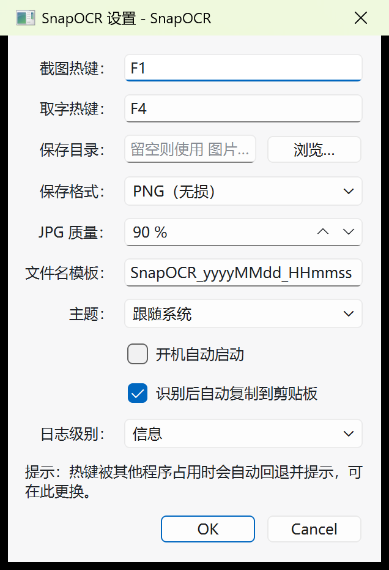

# 完成情况

> 记录项目**实际完成内容、验收证据与未完成工作**，与代码/CI 状态保持同步。
> 最后更新：2026-10-23
> 关联：[需求文档](01-需求文档.md) · [设计文档](02-设计文档.md) · [开发文档](03-开发文档.md)

## 1. 状态总览

图例：✅ 已完成 / 🚧 进行中 / ⬜ 未开始

| 阶段 | 内容 | 状态 | 说明 |
|------|------|------|------|
| 阶段 0 | 仓库、四份文档、可编译骨架、CI、私有远程 | ✅ 2026-10-23 | 构建/测试/冒烟/CI 通过 |
| 阶段一 | 基本常用功能：截图/选区、标注、OCR、热键/托盘/设置/单实例/自启 | ✅ 2026-10-23 | 最小闭环可跑通；11/11 单测 + 端到端脚本全绿（详见 §3） |
| 阶段二 | 适当添加功能：贴图、历史、放大镜/取色、延时、长截图、RapidOCR、高级标注 | ⬜ 未开始 | 范围见开发文档 §7 |
| 阶段三 | 完善前两阶段并发布：兼容性、性能、稳定性、缺陷修复、打包/签名 | ⬜ 未开始 | 范围见开发文档 §8 |

> 当前产品能力：**按下 F1 可截图并标注、复制/保存；按下 F4 可框选取字并复制**；托盘常驻、单实例、设置持久化、开机自启、主题、日志均已可用。

阶段一主界面与典型界面：

| 主窗口 | 设置对话框 |
|----------|-----------|
|  |  |

| 标注编辑 + 工具条 | OCR 结果窗 |
|-------------------|-----------|
|  |  |

## 2. 阶段 0：仓库与骨架（已完成，2026-10-23）

- [x] 本地仓库 `D:\Document\SnapOCR` + GitHub 私有远程 `poluce/SnapOCR`（`main`）。
- [x] 工程配置：`.gitignore`、`.gitattributes`、`.editorconfig`、`.clang-format`。
- [x] CMake 工程：`snapocr_core` 静态库 + `SnapOCR.exe` + 单元测试（源文件 GLOB 自动收集）。
- [x] 构建脚本 `scripts/build.bat`（vcvars64 + Qt/CMake/Ninja 探测 + ctest，支持 `SNAPCOR_BUILD_DIR` 独立构建目录）。
- [x] GitHub Actions CI（Qt 6.10.3 + MSVC + Ninja + ctest + 原生 `windows` 冒烟）。
- [x] 四份文档体系 + ADR 附录。

## 3. 阶段一：基本常用功能（已完成，2026-10-23）

### 3.1 已实现的模块

| 模块 | 实现内容 | 对应需求 |
|------|----------|----------|
| 屏幕捕获 | Win32 GDI 逐显示器 `BitBlt` → `QImage`；显示器枚举（物理/逻辑几何、DPR、主屏）；物理像素权威坐标；多屏拼接裁剪 | F-CAP-02/03/04/09/10 |
| 覆盖层与选区 | 每屏一个置顶无边框窗口；冻结画面 + 暗化遮罩；拖动/8 向控制点缩放/方向键微调；尺寸坐标 HUD；`Enter`/双击确认、`Esc`/右键取消、`Ctrl+A` 全屏 | F-CAP-01/05/06/07/08/11 |
| 标注编辑 | 矩形、椭圆、直线、箭头、画笔、文字、序号、高亮、马赛克；选择/移动/删除；撤销/重做（≥100 步）；颜色/线宽/字号；导出按物理像素 1:1 渲染 | F-ANN-01–15 |
| OCR | C++/WinRT `Windows.Media.Ocr`；语言枚举与缺失引导；QImage→BGRA8→SoftwareBitmap；大图切片（重叠 5%）+ 去重；异步服务（10s 超时、忙时拒绝）；结果窗（语言/耗时/行数、编辑、复制、重新识别）；`F4` 框选自动复制 | F-OCR-01–07 |
| 系统集成 | 全局热键（`RegisterHotKey`，冲突检测 + 回退提示）；托盘菜单（截图/取字/打开主窗口/设置/退出）；单实例（命名互斥体 + 本地套接字命令转发）；设置对话框（热键/目录/格式/JPG 质量/模板/主题/自启/OCR 自动复制/日志级别，见上方截图）；`QSettings` 持久化（损坏回退 `.bak`）；开机自启（HKCU Run）；浅色/深色/跟随系统主题；日志轮转（5MB×3）；剪贴板 PNG+DIB；`--settings` 直接打开设置、`--tray` 仅驻留托盘 | F-SYS-01–10 |
| 输出 | 复制到剪贴板、`Ctrl+S` 按模板保存 PNG/JPG、另存为、同名文件自动加序号 | F-ANN-13/14、F-SYS-07 |

### 3.2 验收证据

**单元测试（14/14 通过）**

| 测试 | 覆盖 |
|------|------|
| `test_version` | 版本常量与单实例键稳定性 |
| `test_coordinate_map` | 物理/逻辑坐标换算、负坐标、混合 DPR、矩形换算、显示器命中 |
| `test_selection_model` | 创建/夹取/移动/缩放/方向键/控制点命中 |
| `test_capture_crop` | 单屏裁剪、跨屏拼接、尺寸恒定 |
| `test_annotation_document` | 底图/图元管理、命中测试、渲染尺寸与像素、马赛克、包围盒 |
| `test_annotation_canvas` | 画布交互：矩形/直线/画笔绘制与坐标换算、撤销/重做、删除选中、序号递增 |
| `test_hotkey_manager` | 键位映射（F 键/字母/数字/修饰键）、非法键与空键拒绝 |
| `test_settings` | 默认值、全字段往返、损坏回退、模板、格式归一化（15 例） |
| `test_startup` | 自启查询/幂等关闭/往返（5 例） |
| `test_ocr_service` | 异步链路、忙时拒绝、超时丢弃迟到结果、引擎失败透传 |
| `test_ocr_text_utils` | 文本整理、切片规划、重复行合并 |
| `test_windows_ocr_engine` | 回归：UI/STA 线程误调用 `recognize()` 时返回中文错误而非断言崩溃或死锁 |
| `test_overlay_toolbar` | 工具条单行布局（选择/编辑两种模式）、18 个按钮齐全、复制为勾号 / 取消为叉号 |
| `snapocr_smoke` | 应用启动与主窗口创建 |

**端到端（真实 Windows 桌面，`scripts/e2e-smoke.ps1`）**

```text
=== SnapOCR e2e smoke (build dir: build) ===
[PASS] app started (pid 45600)
[PASS] F1 -> selection -> Enter copied image (801x601)
[PASS] Ctrl+S saved file: SnapOCR_20261023_140457.png
[PASS] F4 -> selection -> OCR copied 204 characters
[PASS] app closed
=== result: ALL PASS ===
```

**手工/专项验证**

| 检查项 | 方式 | 结果 |
|--------|------|------|
| 屏幕捕获 | `SnapOCR.exe --capture-selftest` | 3840×2160 物理像素、DPR 2.0、图像尺寸与物理一致 |
| 高 DPI 渲染 | 200% 缩放实拍 | 覆盖层/工具条/编辑器/HUD 均正确缩放 |
| 标注烘焙 | 框选 → 矩形工具 → 拖拽 → 回车 | 剪贴板图像 801×601 且含红色矩形 |
| 单实例 | 连续启动两次 | 第二个进程退出码 0，进程数保持 1 |
| 设置持久化 | `SettingsStore` 单测 + 运行时读写 | ini 写入 `%APPDATA%/SnapOCR`（便携模式为 exe 同目录） |
| 日志 | 运行时日志 | `%LOCALAPPDATA%/poluce/SnapOCR/logs/snapocr-yyyyMMdd.log` 正常写入 |
| CI | GitHub Actions | 构建 + ctest + 原生冒烟通过 |

### 3.3 阶段一未覆盖/已知限制

| 项 | 说明 | 影响 |
|----|------|------|
| 多显示器/混合 DPI 实机验证 | 开发机仅单屏（3840×2160 @200%），多屏代码路径已实现并有坐标单测，但**未做真实多屏手测** | 需在双屏环境补测 |
| 标注工具的 UI 级验证 | 矩形/直线/画笔/序号已在画布测试中覆盖；椭圆/箭头/文字/高亮/马赛克由模型测试覆盖 | 建议逐个人工点按验收 |
| 撤销/重做 | 已由 `test_annotation_canvas` 覆盖（撤销移除、重做恢复） | 通过 |
| 托盘菜单/主题切换 | 已实现，未做自动化验证 | 建议人工验收 |
| Windows OCR 中文准确率 | 实测存在错字（如“中文识别测试”→“中 文 识 别 测 试”）；`normalizeText` 可去空格但无法纠错 | 阶段二引入 RapidOCR 改善 |
| 编辑态隐藏覆盖层 | 进入标注编辑时覆盖层隐藏（避免置顶窗口互相遮挡），选区外显示实时桌面而非冻结暗化 | 体验与 Snipaste 略有差异，可在阶段三优化为统一 backdrop 窗口 |
| 首次进入编辑态焦点 | 通过延迟激活修复“第一次点击被吞”，但在极慢机器上仍可能吞掉一次点击 | 已记录，阶段三做更稳妥的激活策略 |
| 全屏独占/DRM | GDI 无法捕获 | 明确不支持 |
| OCR 线程约束 | `Windows.Media.Ocr` 必须在**非 GUI、非 STA 的后台线程**调用：在 STA 线程会触发 WinRT Debug 断言 `!is_sta_thread()`（曾用临时探针复现），在 GUI 线程阻塞等待异步结果会死锁。正常路径由 `OcrService` 在 worker 线程执行；`WindowsOcrEngine::recognize()` 已加双重防护（GUI 线程 + STA 线程检测），误用时返回中文错误而不是崩溃/卡死 | 已修复并有回归测试 |
| 贴图/历史/长截图 | 属阶段二 | 见开发文档 §7 |

## 3.4 发布 v0.0.1（2026-10-23）

首个可运行版本，覆盖阶段一全部功能。

| 项 | 内容 |
|----|------|
| 版本 | `0.0.1`（`CMakeLists.txt` 的 `project(VERSION)`，注入到 `snapocr/Version.h`） |
| 制品 | `SnapOCR-0.0.1-win64.zip`（绿色版，解压即用，约 13 MB / 解压后约 30 MB） |
| 打包 | `scripts\package.bat Release`：`build.bat` 出 Release → `windeployqt` 部署 Qt 依赖 → `Compress-Archive` 打包 |
| 运行时 | Qt 6.11.1 + MSVC 2022 运行库（`--compiler-runtime` 一并部署）；免安装、免管理员权限 |
| 验证 | Release 构建 ctest 13/13；Release 端到端全 PASS；**从 PATH 移除 Qt** 后运行 `--version` / `--smoke-test` 均 exit 0 |

发布命令与流程见开发文档 §0.4。

## 4. 阶段二、三（未开始）

| 阶段 | 待办摘要 |
|------|----------|
| 阶段二 | 贴图（F-ANN-19/20）、截图历史（F-CAP-17）、放大镜/取色（F-CAP-14）、延时截图（F-CAP-13）、窗口识别（F-CAP-15）、长截图（F-CAP-16）、高斯模糊/图元缩放/形状样式（F-ANN-16–18）、RapidOCR 引擎切换（F-OCR-10）、段落整理（F-OCR-08/09）、便携模式/拖拽保存（F-SYS-11/12） |
| 阶段三 | 多屏混合 DPI/RDP/旋转全矩阵、性能达标、稳定性与缺陷收敛、绿色包与安装包、签名、i18n/CLI |

## 5. 已知问题与风险

| 项 | 状态 | 说明 / 处理 |
|----|------|-------------|
| Windows OCR 中文准确率 | 已知 | 阶段二 RapidOCR；结果窗可手工修正 |
| 多屏混合 DPI 未实机验证 | 待验证 | 阶段三手测矩阵 |
| CI 与本地 Qt 版本不同 | 已接受 | CI 6.10.3（aqtinstall 兼容），本地 6.11.1，源码保持 6.5+ 兼容 |
| 未安装 .NET SDK | 已确认 | 技术栈 C++/Qt，不受影响 |
| 代码签名 / 安装包 | 未开始 | 阶段三 |
| 编辑态覆盖层隐藏 | 设计取舍 | 阶段三可改为统一 backdrop |

## 6. 复现命令

```bat
:: 构建 + 单测
scripts\build.bat Debug

:: 端到端（真实桌面，会注入键鼠）
powershell -NoProfile -ExecutionPolicy Bypass -File scripts\e2e-smoke.ps1 -BuildDir build

:: 屏幕捕获自检
build\SnapOCR.exe --capture-selftest

:: 启动（托盘常驻 / 带主窗口）
build\SnapOCR.exe --tray
build\SnapOCR.exe
```

## 7. 文档变更记录

| 日期 | 变更 |
|------|------|
| 2026-10-23 | 创建四份文档体系（需求/设计/开发/完成情况） |
| 2026-10-23 | 阶段 0 完成并记录验收证据 |
| 2026-10-23 | 需求任务改为三阶段交付 |
| 2026-10-23 | 阶段一（M1–M4）实现完成，补充验收证据、界面截图与已知限制 |
