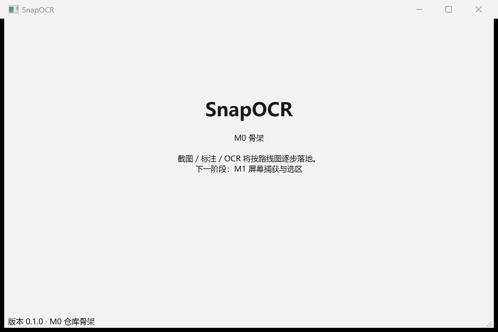

# 完成情况

> 记录项目**实际完成内容、验收证据与未完成工作**，与代码/CI 状态保持同步。
> 最后更新：2026-10-23
> 关联：[需求文档](01-需求文档.md) · [设计文档](02-设计文档.md) · [开发文档](03-开发文档.md)

## 1. 状态总览

图例：✅ 已完成 / 🚧 进行中 / ⬜ 未开始

| 阶段 | 内容 | 状态 | 说明 |
|------|------|------|------|
| 阶段 0 | 仓库、四份文档、可编译骨架、CI、私有远程 | ✅ 2026-10-23 | 构建/测试/冒烟/CI 全部通过 |
| 阶段一 | 基本常用功能：截图/选区、基础标注、OCR 取字、热键/托盘/设置基础（M1–M4） | ⬜ 未开始 | 下一阶段；范围见开发文档 §3–§6 |
| 阶段二 | 适当添加功能：贴图、历史、放大镜/取色、延时、长截图、RapidOCR、高级标注 | ⬜ 未开始 | P1 增强；范围见开发文档 §7 |
| 阶段三 | 完善阶段一/二并发布：兼容性、性能、稳定性、缺陷修复、打包/签名/文档 | ⬜ 未开始 | 发布阶段；范围见开发文档 §8 |

> 当前产品能力：**仅可启动的占位主窗口 + CLI 自检**；截图、标注、OCR 等用户功能均未实现。

## 2. 已完成：阶段 0（原 M0）仓库与骨架（2026-10-23）

### 2.1 交付清单

- [x] 本地仓库 `D:\Document\SnapOCR`，`main` 分支；GitHub 私有远程 `poluce/SnapOCR`。
- [x] 工程配置：`.gitignore`、`.gitattributes`（bat=CRLF）、`.editorconfig`、`.clang-format`。
- [x] CMake 工程：`snapocr_core` 静态库 + `SnapOCR.exe`（WIN32 GUI）+ `snapocr_tests`；版本号由 `cmake/Version.h.in` 注入。
- [x] 应用骨架：命令行 `--version/--help/--smoke-test`、Win32 控制台挂接、占位主窗口。
- [x] 构建脚本：`scripts/build.bat`（vcvars64 + Qt/CMake/Ninja 探测 + ctest）、`scripts/run.bat`。
- [x] GitHub Actions CI：Qt 6.10.3 + MSVC + Ninja + ctest + 原生 `windows` 平台冒烟。
- [x] 文档整合为四份：需求 / 设计 / 开发 / 完成情况（本文件）。
- [x] 文档配图：`docs/assets/m0-window.png`（阶段 0 主窗口实拍）。

### 2.2 验收证据

| 检查项 | 命令 / 方式 | 结果 |
|--------|-------------|------|
| 构建 | `scripts\build.bat Debug` | ✅ MSVC 19.51 + Qt 6.11.1，14 个构建步骤通过 |
| 单元测试 | `ctest --test-dir build --output-on-failure` | ✅ 2/2 通过（`snapocr_tests`、`snapocr_smoke`） |
| 冒烟（真实 Windows 平台） | `build\SnapOCR.exe --smoke-test` | ✅ `platform=windows`，PASS，exit 0 |
| 版本 | `build\SnapOCR.exe --version` | ✅ `SnapOCR 0.1.0` |
| GUI 实际启动 | PowerShell `Start-Process` + PrintWindow | ✅ 窗口标题 `SnapOCR`、响应正常、关闭后 exit 0；200% DPI 渲染正确 |
| CI（干净环境） | GitHub Actions run `39898078414` | ✅ 全部步骤通过；此前 run `39897702654` 因 aqt 不支持 Qt 6.11 布局失败，已修复 |
| OCR 可行性（探针） | PowerShell + WinRT `Windows.Media.Ocr` | ✅ `zh-Hans-CN` 引擎可用；一张中文界面截图识别 59ms；准确率一般（为 P1 RapidOCR 提供依据） |
| 仓库 | `gh repo view poluce/SnapOCR` | ✅ PRIVATE，`main` 已同步 |

阶段 0 主窗口实拍：

### 2.3 当前可运行产物

- `build/SnapOCR.exe`（本地构建产物，**不入库**，`.gitignore` 已忽略）；
- 启动方式：`scripts\run.bat`；CLI：`build\SnapOCR.exe --version|--help|--smoke-test`；
- 当前窗口内容为阶段 0 占位页与版本状态栏，无业务功能。

## 3. 需求实现状态

需求编号与验收标准见 [需求文档 §6](01-需求文档.md)，阶段映射见 [需求文档 §6.0.1](01-需求文档.md)；以下按**交付阶段**统计实现状态（不是文档规划状态）。

| 阶段 | 需求范围 | 状态 | 说明 |
|------|----------|------|------|
| 阶段 0 | 工程准备（非用户功能） | ✅ 完成 | 仓库/文档/骨架/CI |
| 阶段一 | F-CAP-01–11、F-ANN-01–15、F-OCR-01–07、F-SYS-01–10 | ⬜ 未开始 | 基本常用功能 |
| 阶段二 | F-CAP-12–17、F-ANN-16–20、F-OCR-08–10、F-SYS-11/12 | ⬜ 未开始 | 适当添加 P1 功能 |
| 阶段三 | 前两阶段完善 + 发布工程（P2 部分可选项） | ⬜ 未开始 | 质量完善与发布 |
| P2 候选 | 录屏、二维码、翻译、云分享等 | ⬜ 未开始 | 阶段三之后的候选，不承诺 |
| 非功能需求 | N-PERF / N-COMPAT / N-SEC / N-UX / N-MAINT / N-SIZE / N-REL | 🚧 部分 | 仅构建/CI/单测骨架；待阶段一起逐步验证 |

## 4. 未完成工作与下一步（阶段一）

阶段一目标：完成基本常用功能（M1–M4），使最小闭环和日常截图/标注/取字可用。
**下一步先做 M1（截图与选区）**：`F1` → 冻结画面 → 框选 → `Enter` 复制 PNG / `Ctrl+S` 保存；多屏与混合 DPI 正确。

| 任务 | 产物 |
|------|------|
| 显示器布局与坐标 | `MonitorLayout`、物理/逻辑坐标换算 + 单测 |
| GDI 逐屏捕获 | `Win32ScreenCapture`、`CaptureResult`、失败错误码 |
| 全局热键 | `HotkeyManager`（RegisterHotKey + native event filter，冲突检测） |
| 逐屏覆盖层与选区 | `OverlayController`/`OverlayWindow`/`SelectionModel`（拖动、8 向缩放、键盘微调） |
| 输出闭环 | 选区裁剪、剪贴板 PNG+DIB、快速保存、`Esc` 无残留 |
| 测试与验收 | 坐标/选区单测；多屏混合 DPI 手测；CI 绿 |

阶段一其余子阶段：M2 标注基础、M3 OCR 基础、M4 系统集成基础，任务见 [开发文档 §4–§6](03-开发文档.md)。

## 5. 已知问题与风险

| 项 | 状态 | 说明 / 处理 |
|----|------|-------------|
| 产品功能为 0 | 已知 | 仅阶段 0 骨架，属计划内；阶段一起进入功能开发 |
| Windows OCR 中文准确率一般 | 已知 | 探针实测有错字；阶段一建立基准集，未达标则阶段二提前 RapidOCR |
| CI 与本地 Qt 版本不同 | 已接受 | CI 固定 Qt 6.10.3（aqtinstall 不支持 6.11 新布局），本地 6.11.1，源码保持 Qt 6.5+ 兼容 |
| 未安装 .NET SDK | 已确认 | 技术栈为 C++/Qt，不受影响 |
| 代码签名 / 安装包 | 未开始 | P2；当前仅本地绿色运行 |
| 全屏独占/DRM 黑屏 | 设计限制 | 明确不支持并提示，不做绕过 |

## 6. 文档变更记录

| 日期 | 变更 |
|------|------|
| 2026-10-23 | 创建四份文档体系（需求/设计/开发/完成情况）；由原 PLAN、PRD、技术设计、路线图、开发规范、ADR 整合而来 |
| 2026-10-23 | 阶段 0 完成并记录验收证据；确定阶段一为下一阶段 |
| 2026-10-23 | 需求任务改为三阶段交付（基本常用 → 适当添加 → 完善发布）；状态表同步为阶段 0/一/二/三 |
