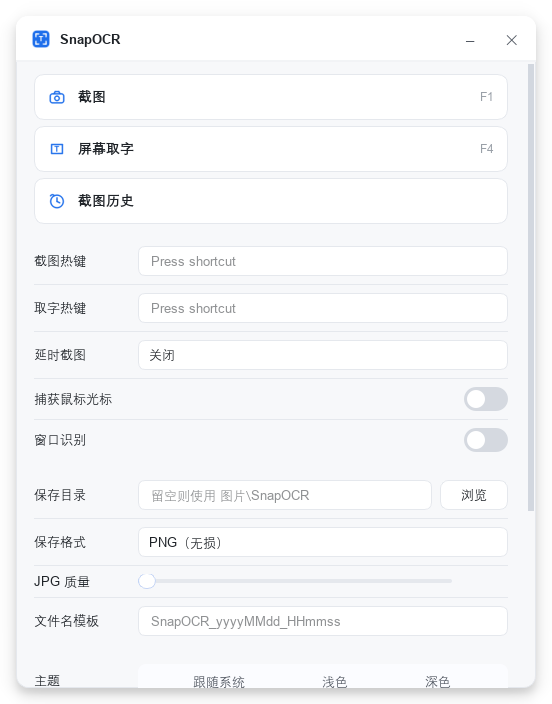
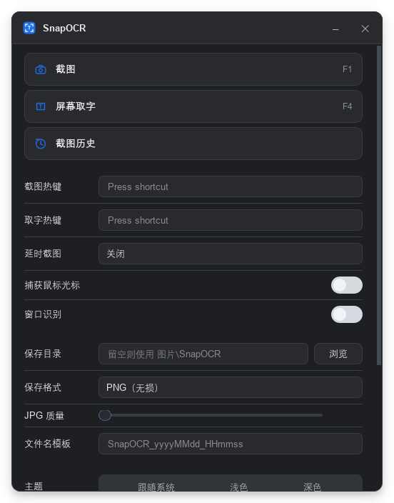
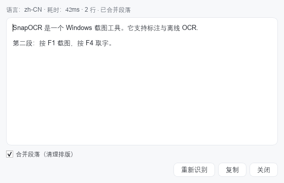
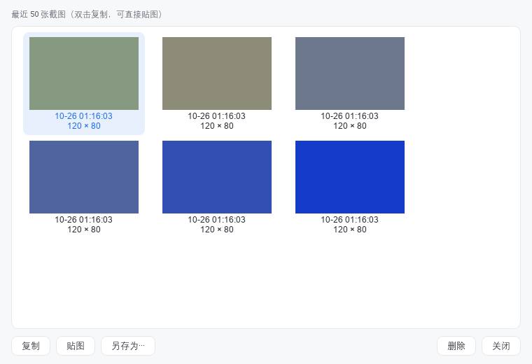

# 完成情况

> 记录项目**实际完成内容、验收证据与未完成工作**，与代码/CI 状态保持同步。
> 最后更新：2026-10-23
> 关联：[需求文档](01-需求文档.md) · [设计文档](02-设计文档.md) · [开发文档](03-开发文档.md)

## 1. 状态总览

图例：✅ 已完成 / 🚧 进行中 / ⬜ 未开始

| 阶段 | 内容 | 状态 | 说明 |
|------|------|------|------|
| 阶段 0 | 仓库、四份文档、可编译骨架、CI、私有远程 | ✅ 2026-10-23 | 构建/测试/冒烟/CI 通过 |
| 阶段一 | 基本常用功能：截图/选区、标注、OCR、热键/托盘/设置/单实例/自启 | ✅ 2026-10-23 | 最小闭环可跑通；11/11 单测 + 端到端脚本全绿（详见 §3） |
| 阶段二 | 适当添加功能：贴图、历史、放大镜/取色、延时、长截图、RapidOCR、高级标注 | ✅ 完成（RapidOCR 延后） | 除 F-OCR-10（P1 可选项）外全部落地，验收记录见 §3.8 |
| 阶段三 | 完善前两阶段并发布 | 🚧 进行中 | 版本 0.1.0；发布工程/主题一致性/多显示器矩阵 |
| 阶段三 | 完善前两阶段并发布：兼容性、性能、稳定性、缺陷修复、打包/签名 | ⬜ 未开始 | 范围见开发文档 §8 |

> 当前产品能力：**按下 F1 可截图并标注、复制/保存；按下 F4 可框选取字并复制**；托盘常驻、单实例、设置持久化、开机自启、主题、日志均已可用。

阶段一主界面与典型界面：

| 主窗口（操作入口 + 设置合一） |
|--------------------------------|
|  |

| 标注编辑 + 工具条 | OCR 结果窗 |
|-------------------|-----------|
|  |  |

## 2. 阶段 0：仓库与骨架（已完成，2026-10-23）

- [x] 本地仓库 `D:\Document\SnapOCR` + GitHub 私有远程 `poluce/SnapOCR`（`main`）。
- [x] 工程配置：`.gitignore`、`.gitattributes`、`.editorconfig`、`.clang-format`。
- [x] CMake 工程：`snapocr_core` 静态库 + `SnapOCR.exe` + 单元测试（源文件 GLOB 自动收集）。
- [x] 构建脚本 `scripts/build.bat`（vcvars64 + Qt/CMake/Ninja 探测 + ctest，支持 `SNAPCOR_BUILD_DIR` 独立构建目录）。
- [x] GitHub Actions CI（Qt 6.10.3 + MSVC + Ninja + ctest + 原生 `windows` 冒烟）。
- [x] 四份文档体系 + ADR 附录。

## 3. 阶段一：基本常用功能（已完成，2026-10-23）

### 3.1 已实现的模块

| 模块 | 实现内容 | 对应需求 |
|------|----------|----------|
| 屏幕捕获 | Win32 GDI 逐显示器 `BitBlt` → `QImage`；显示器枚举（物理/逻辑几何、DPR、主屏）；物理像素权威坐标；多屏拼接裁剪 | F-CAP-02/03/04/09/10 |
| 覆盖层与选区 | 每屏一个置顶无边框窗口；冻结画面 + 暗化遮罩；拖动/8 向控制点缩放/方向键微调；尺寸坐标 HUD；`Enter`/双击确认、`Esc`/右键取消、`Ctrl+A` 全屏 | F-CAP-01/05/06/07/08/11 |
| 标注编辑 | 矩形、椭圆、直线、箭头、画笔、文字、序号、高亮、马赛克；选择/移动/删除；撤销/重做（≥100 步）；颜色/线宽/字号；导出按物理像素 1:1 渲染 | F-ANN-01–15 |
| OCR | C++/WinRT `Windows.Media.Ocr`；语言枚举与缺失引导；QImage→BGRA8→SoftwareBitmap；大图切片（重叠 5%）+ 去重；异步服务（10s 超时、忙时拒绝）；结果窗（语言/耗时/行数、编辑、复制、重新识别）；`F4` 框选自动复制 | F-OCR-01–07 |
| 系统集成 | 全局热键（`RegisterHotKey`，冲突检测 + 回退提示）；托盘菜单（截图/取字/打开主窗口/设置/退出）；单实例（命名互斥体 + 本地套接字命令转发）；设置对话框（**无边框 + 自建标题栏 + 卡片式分组 + 开关/分段选择/滑块**，含热键/目录/格式/JPG 质量/模板/主题/自启/OCR 自动复制/日志级别，见上方截图）；`QSettings` 持久化（损坏回退 `.bak`）；开机自启（HKCU Run）；浅色/深色/跟随系统主题；日志轮转（5MB×3）；剪贴板 PNG+DIB；`--settings` 直接打开设置、`--tray` 仅驻留托盘 | F-SYS-01–10 |
| 输出 | 复制到剪贴板、`Ctrl+S` 按模板保存 PNG/JPG、另存为、同名文件自动加序号 | F-ANN-13/14、F-SYS-07 |

### 3.2 验收证据

**单元测试（14/14 通过）**

| 测试 | 覆盖 |
|------|------|
| `test_version` | 版本常量与单实例键稳定性 |
| `test_coordinate_map` | 物理/逻辑坐标换算、负坐标、混合 DPR、矩形换算、显示器命中 |
| `test_selection_model` | 创建/夹取/移动/缩放/方向键/控制点命中 |
| `test_capture_crop` | 单屏裁剪、跨屏拼接、尺寸恒定 |
| `test_annotation_document` | 底图/图元管理、命中测试、渲染尺寸与像素、马赛克、包围盒 |
| `test_annotation_canvas` | 画布交互：矩形/直线/画笔绘制与坐标换算、撤销/重做、删除选中、序号递增 |
| `test_hotkey_manager` | 键位映射（F 键/字母/数字/修饰键）、非法键与空键拒绝 |
| `test_settings` | 默认值、全字段往返、损坏回退、模板、格式归一化（15 例） |
| `test_startup` | 自启查询/幂等关闭/往返（5 例） |
| `test_ocr_service` | 异步链路、忙时拒绝、超时丢弃迟到结果、引擎失败透传 |
| `test_ocr_text_utils` | 文本整理、切片规划、重复行合并 |
| `test_windows_ocr_engine` | 回归：UI/STA 线程误调用 `recognize()` 时返回中文错误而非断言崩溃或死锁 |
| `test_overlay_toolbar` | 工具条单行布局（选择/编辑两种模式）、18 个按钮齐全、复制为勾号 / 取消为叉号 |
| `test_tool_icons` | 图标多档物理尺寸（20/40/60/80）、DPR 取图正确 |
| `test_settings_panel` | 设置面板全字段往返、改动触发 settingsChanged、加载时不误触发、主窗口内嵌面板 |
| `snapocr_smoke` | 应用启动与主窗口创建 |

**端到端（真实 Windows 桌面，`scripts/e2e-smoke.ps1`）**

```text
=== SnapOCR e2e smoke (build dir: build) ===
[PASS] app started (pid 45600)
[PASS] F1 -> selection -> Enter copied image (801x601)
[PASS] Ctrl+S saved file: SnapOCR_20261023_140457.png
[PASS] F4 -> selection -> OCR copied 204 characters
[PASS] app closed
=== result: ALL PASS ===
```

**手工/专项验证**

| 检查项 | 方式 | 结果 |
|--------|------|------|
| 屏幕捕获 | `SnapOCR.exe --capture-selftest` | 3840×2160 物理像素、DPR 2.0、图像尺寸与物理一致 |
| 高 DPI 渲染 | 200% 缩放实拍 | 覆盖层/工具条/编辑器/HUD 均正确缩放 |
| 标注烘焙 | 框选 → 矩形工具 → 拖拽 → 回车 | 剪贴板图像 801×601 且含红色矩形 |
| 单实例 | 连续启动两次 | 第二个进程退出码 0，进程数保持 1 |
| 设置持久化 | `SettingsStore` 单测 + 运行时读写 | ini 写入 `%APPDATA%/SnapOCR`（便携模式为 exe 同目录） |
| 日志 | 运行时日志 | `%LOCALAPPDATA%/poluce/SnapOCR/logs/snapocr-yyyyMMdd.log` 正常写入 |
| CI | GitHub Actions | 构建 + ctest + 原生冒烟通过 |

### 3.3 阶段一未覆盖/已知限制

| 项 | 说明 | 影响 |
|----|------|------|
| 多显示器/混合 DPI 实机验证 | 开发机仅单屏（3840×2160 @200%），多屏代码路径已实现并有坐标单测，但**未做真实多屏手测** | 需在双屏环境补测 |
| 标注工具的 UI 级验证 | 矩形/直线/画笔/序号已在画布测试中覆盖；椭圆/箭头/文字/高亮/马赛克由模型测试覆盖 | 建议逐个人工点按验收 |
| 撤销/重做 | 已由 `test_annotation_canvas` 覆盖（撤销移除、重做恢复） | 通过 |
| 托盘菜单/主题切换 | 已实现，未做自动化验证 | 建议人工验收 |
| Windows OCR 中文准确率 | 实测存在错字（如“中文识别测试”→“中 文 识 别 测 试”）；`normalizeText` 可去空格但无法纠错 | 阶段二引入 RapidOCR 改善 |
| 编辑态覆盖层 | 已改为**保留覆盖层**（选区外持续显示暗化冻结画面），仅将选区设为不可交互；遮挡问题靠显式 raise 顺序解决 | 已解决 |
| 首次进入编辑态焦点 | 通过延迟激活修复“第一次点击被吞”，但在极慢机器上仍可能吞掉一次点击 | 已记录，阶段三做更稳妥的激活策略 |
| 工具条点击 | 自动化脚本瞬时移动光标会导致点击坐标陈旧（测试脚本问题，非产品问题）；真人移动鼠标操作正常 | 已在测试脚本改为分步移动 |
| 全屏独占/DRM | GDI 无法捕获 | 明确不支持 |
| OCR 线程约束 | `Windows.Media.Ocr` 必须在**非 GUI、非 STA 的后台线程**调用：在 STA 线程会触发 WinRT Debug 断言 `!is_sta_thread()`（曾用临时探针复现），在 GUI 线程阻塞等待异步结果会死锁。正常路径由 `OcrService` 在 worker 线程执行；`WindowsOcrEngine::recognize()` 已加双重防护（GUI 线程 + STA 线程检测），误用时返回中文错误而不是崩溃/卡死 | 已修复并有回归测试 |
| 贴图/历史/长截图 | 属阶段二 | 见开发文档 §7 |

## 3.4 发布 v0.0.1（2026-10-23）

首个可运行版本，覆盖阶段一全部功能。

| 项 | 内容 |
|----|------|
| 版本 | `0.0.1`（`CMakeLists.txt` 的 `project(VERSION)`，注入到 `snapocr/Version.h`） |
| 制品 | `SnapOCR-0.0.1-win64.zip`（绿色版，解压即用，约 13 MB / 解压后约 30 MB） |
| 打包 | `scripts\package.bat Release`：`build.bat` 出 Release → `windeployqt` 部署 Qt 依赖 → `Compress-Archive` 打包 |
| 运行时 | Qt 6.11.1 + MSVC 2022 运行库（`--compiler-runtime` 一并部署）；免安装、免管理员权限 |
| 验证 | Release 构建 ctest 13/13；Release 端到端全 PASS；**从 PATH 移除 Qt** 后运行 `--version` / `--smoke-test` 均 exit 0 |

发布命令与流程见开发文档 §0.4。

## 3.4.1 主窗口与设置合并（2026-10-26）

按「现代小工具」思路把主页与设置合并成一个窗口（原两个窗口维护两套样式且来回切换割裂）：

- 主窗口：无边框 + 自建标题栏（图标/标题/最小化/关闭到托盘），
  内容 = 品牌头部（图标/名称/v0.0.1 徽标）+ 两个操作卡片（截图 F1 / 屏幕取字 F4）+ 提示卡 +
  设置面板 + 状态栏，整体可滚动
- 设置改为 `SettingsPanel` 内嵌：卡片分组、开关、分段选择、滑块保持不变，
  但**去掉确定/取消，改动即时生效**（`settingsChanged` → `applySettings` → 持久化）
- 热键在 `editingFinished` 后应用；注册失败自动回滚并在状态栏提示
- 删除 `SettingsDialog`（窗口 + 文件），托盘「设置」/`--settings` 改为打开主窗口并滚动到设置区

坑：`QMainWindow` 不能直接 `new QVBoxLayout(this)`，必须用 `setCentralWidget()`，
否则内容完全不渲染（表现为整窗只有标题栏）。

## 3.4.2 界面简约化（2026-10-26）

功能不多，界面进一步收敛，去掉一切非必要装饰：

- 删除主窗口的大品牌头部（图标/大标题/副标题/v0.0.1 徽标块）与提示卡片
- 操作入口从「大卡片 + 说明文字」改为两行紧凑按钮（图标 + 名称 + 右侧热键）
- 设置去掉 5 个分组卡片与小标题，改为**扁平行式**布局，仅用缩进分隔线区分；
  行高、间距、控件高度统一收紧（窗口宽 520）
- 版本号移到右下角状态行（与「就绪」同行）；窗口高度按内容自动定型，内容不多时不出现滚动条
- 结果：整窗 552×721（含阴影边距），一屏看完，无滚动

## 3.10 阶段三进展：稳定性审计与崩溃日志（2026-10-26）

| 项 | 实现 | 证据 |
|----|------|------|
| 资源审计 | `platform/win32/ProcessMetrics`：句柄数、GDI/USER 对象数、工作集/峰值工作集；`--stability-selftest` 跑 20 轮「全屏捕获 + 区域捕获 + 标注渲染（含模糊）+ PNG 编码」 | `handles 260→264 (+4)`、`gdi 2→2 (+0)`、`user 17→19 (+2)`、`ws 95→63MB`，判定 PASS |
| 崩溃日志 | `platform/win32/CrashReporter`：`SetUnhandledExceptionFilter` + `std::terminate`，纯 Win32 写文件（异常现场不能用 Qt） | `--crash-selftest` 触发 0xC0000005，进程退出码 0xC0000005，写出 `crash-20261026-023607.txt`（含 reason/exception code/address/time） |
| DXGI 评估 | 结论：暂不替换 GDI（当前 58ms/18ms 已达目标；DXGI 需 D3D11 设备与独占全屏/保护内容等错误恢复，复杂度不划算） | 记录于设计文档 §17 |

## 3.9 阶段三进展：主题一致性（2026-10-26）

阶段三的第一项：自绘窗口此前全部硬编码浅色，切换暗色主题后主窗口/对话框仍是白底。
本轮把主题真正打通：

| 项 | 实现 |
|----|------|
| 主题色板 | `ui::ThemeColors`（window/surface/border/text/accent/danger/scrollbar 等 12 个 token），light/dark 两套 |
| QSS 占位符 | `ui::styled("{window} …")` 按当前主题替换颜色；主窗口/设置/历史/OCR/滚动控制条统一走模板 |
| 自绘控件 | 标题栏（背景/分隔线）、ToggleSwitch（轨道/旋钮/焦点环）改为按 `themeColors()` 实时取色 |
| 主题变更 | `ThemeNotifier::themeChanged` 广播；`applyTheme` 同时刷新调色板、全局兜底 QSS，并强制所有控件重绘 |
| 跟随系统 | 用 `QStyleHints::colorScheme()` 判定，系统切换时自动跟随（仅 system 模式） |

验证：
- 新增 `test_theme`（4 条）：两套色板差异、`styled()` 替换、调色板跟随、主窗口两种主题渲染结果必须不同
- 离屏渲染两套主题文档图（`assets/phase3-theme-light.png` / `phase3-theme-dark.png`），实测暗色下标题栏/卡片/输入框/开关全部跟随
- 31/31 测试套件通过




## 3.8 阶段二收官与验收（2026-10-26）

阶段二共落地 13 项 P1 功能（截图 6 项、标注 5 项、OCR 2 项）与便携模式，验收结论：

| 验收项 | 结论 | 证据 |
|--------|------|------|
| P1 功能可用、入口可发现 | ✅ | 工具条新增 模糊/长截图/贴图/填充/虚线 按钮；主窗口/托盘新增 截图历史；设置新增 延时截图/捕获光标/窗口识别/复制后贴图 |
| 阶段一无回归 | ✅ | 30 个测试套件全绿；CI 原生 windows 冒烟通过 |
| 性能不退化 | ✅ | `--capture-selftest`：4K 全屏 58ms、区域 18ms；模糊底图/窗口枚举按需执行 |
| 代码质量 | ✅ | 新增 8 个测试套件（cursor/logging/image_saver/pin/history/ocr_hints/ocr_dialog/window_detector/scrolling×2 等），模型层纯函数化 |
| 延后项 | ⚠️ | `F-OCR-10` RapidOCR：需 ONNX Runtime + det/cls/rec 模型（20MB+），属 P1 可选项，阶段三评估后单独立项 |

阶段三启动（版本 0.1.0）：发布说明 `docs/releases/v0.1.0.md`；CI 增加 windeployqt 打包与
artifact 上传；性能基线数据登记；主题一致性与多显示器矩阵待做。

## 3.7 阶段二进展：截图增强与便携模式（2026-10-26）

阶段二第一批（P1）已落地：

| 需求 | 实现 | 验证 |
|------|------|------|
| `F-CAP-12` 捕获鼠标光标 | 新增 `platform/win32/CursorCapture`：`GetCursorInfo` → `GetIconInfo` → 颜色位图 + 掩码位图手工合成 alpha → 画到光标所在屏幕的图像上。设置项「捕获鼠标光标」默认关闭 | `test_cursor_capture`（系统图标转换、热点范围、可见像素） |
| `F-CAP-13` 延时截图 | 设置项「延时截图」（关闭/1/2/3/5/10 秒）；倒计时期间托盘提示并忽略重复触发，到点后按原模式（截图/取字）开始 | 运行时验证：delay=3s 时 0.6s 无覆盖层、3.6s 出现覆盖层 |
| `F-SYS-11` 便携模式 | `SnapOCR.portable` 标记存在时，配置与日志都落在 exe 同目录 | `test_logging`（标记存在/不存在两种路径） |
| `F-CAP-16` 滚动长截图 | `capture/ScrollingStitch`（纯计算）：行采样搜索垂直重叠位移，按新增 `offset` 行累加拼接；`ScrollingCaptureController` 抓帧状态机（注入 FrameProvider，500ms/帧，页面连续 3 帧不变自动结束，Esc 取消/Enter 完成）；`platform/win32/ScreenCapture::captureRegion` 区域抓取；`ui/ScrollingBar` 悬浮控制条；工具条「滚动长截图」入口，结果复制并进历史 | `test_scrolling_stitch`（8 条：已知位移/无关帧拒绝/等高校验/重复帧跳过/宽度不一致/空帧）、`test_scrolling_capture`（4 条：抓帧失败/拼接完成/自动结束/取消）；`--capture-selftest` 增加区域捕获断言（实测 `region: 120x80` PASS） |
| `F-CAP-15` 窗口识别 | `platform/win32/WindowDetector`：按 Z 序枚举顶层窗口找光标下的目标（覆盖层在最顶层，`WindowFromPoint` 不可用），过滤自身进程/桌面壳/cloak/过小/整屏，DWM 可见边框；覆盖层 50ms 轮询驱动悬停高亮，单击把窗口矩形设为选区 | `test_window_detector`（5 条纯几何 + 1 条真实平台集成：创建探针窗口→枚举命中→标题/矩形校验）；集成用例在 offscreen 下跳过 |
| `F-ANN-16` 模糊笔刷 | `AnnotationKind::Blur` + `annotate/ImageBlur::gaussianBlur`（三次盒式模糊）；底图模糊结果按需生成并缓存；用 `QPainterPathStroker` 生成笔画轮廓后裁剪贴图，避免整图重绘 | `test_image_blur`（4 条：零半径/尺寸不变/方差下降/边界）、`test_annotation_document::blurStrokeChangesPixels`、`test_annotation_canvas::drawsBlurStroke` |
| `F-ANN-17` 图元缩放/层级 | 四角控制点拖拽缩放（按内容包围盒换算，文字同步字号）；`Ctrl+]`/`Ctrl+[` 上下移层，`Ctrl+Shift+]`/`Ctrl+Shift+[` 置顶置底 | `test_annotation_document`（缩放 3 条 + 层级 2 条）、`test_annotation_canvas`（控制点拖拽、层级快捷键） |
| `F-ANN-18` 填充/虚线 | `AnnotationStyle.filled/.dashed`；工具条「填充」「虚线」开关；虚线 dash pattern 随线宽 | `test_overlay_toolbar`（按钮存在）、渲染由绘制路径覆盖 |
| `F-OCR-08` 段落合并 | `OcrResult.cleanText`（引擎原始 `fullText` 与清理后 `cleanText` 分离）：合并被排版拆断的段落、压缩多余空格、删除汉字间空格；结果窗默认显示合并文本并可切回原始换行；自动复制用合并文本 | `test_ocr_text_utils`（既有 8 条）、`test_ocr_service`（cleanText 断言）、`test_ocr_result_dialog`（默认合并 / 切回原文） |
| `F-OCR-09` 失败重试与裁边提示 | `ocr/OcrHints`：语言包缺失→安装路径指引、选区 <12px→扩大选区、超时→缩小选区、贴屏边→裁字提示、空结果→纯图片/对比度提示；「重新识别」按钮复用上一张图 | `test_ocr_hints`（7 条：各分支 + 贴边判定）、`test_ocr_result_dialog`（失败提示） |
| `F-CAP-17` 截图历史 | `history/HistoryStore`：PNG 落盘、上限 50 张自动裁剪、连续同图去重（复制+贴图不重复入库）、删除同步删文件；`ui/HistoryDialog` 缩略图网格（双击复制）＋复制/贴图/另存为/删除；主窗口新增「截图历史」入口，托盘菜单同步 | `test_history_store`（落盘/去重/容量裁剪/删除/读回/空图）、`test_history_dialog`（列表、删除联动、空状态、离屏渲染） |
| `F-ANN-19` 贴图 | 置顶无边框窗（`ui/PinWindow`）：系统拖动、滚轮缩放 0.1–4x（光标为锚点）、Ctrl+滚轮透明度、R 旋转、Esc/右键菜单关闭、Ctrl+C/S；截图按屏幕 DPR 换算逻辑尺寸，200% 屏不会超出屏幕 | `test_pin_window`（初始尺寸/缩放夹取/旋转换边/图像不被修改） |
| `F-ANN-20` 复制后自动贴图 | 设置项「复制后自动贴图」（`editor/pinOnCopy`，默认关闭）；选区工具条新增「贴图」按钮 | `test_settings_panel` 往返；`test_overlay_toolbar` 断言按钮存在 |
| `F-CAP-14` 放大镜 + 取色 | 覆盖层内绘制 11×11 像素网格 + 中心高亮 + 色块/HEX/RGB；光标 50ms 轮询驱动（覆盖层非拖拽时收不到鼠标移动事件）；按 `C` 复制 HEX 到剪贴板 | `test_color_magnifier`（取样/夹取/文本/面板位置/绘制）、`test_overlay_magnifier`（离屏渲染整个覆盖层并断言面板已绘制）；运行时 PrintWindow 实测显示 `#0920B8 / RGB 9, 32, 184` |

实现要点（都是踩坑后定的）：
- 放大镜不做成独立控件：覆盖层只有在拖拽（鼠标捕获）时才收到鼠标移动事件，
  且独立子控件还受父窗口绘制顺序影响；改为纯绘制助手 + 覆盖层 `paintEvent` 内绘制。
- 绘制位置必须在「无选区提前返回」之前，否则空选区时看不到放大镜。
- `copyTextToClipboard` 增加读回校验与重试：其他程序短暂占用剪贴板时 Qt 会静默失败。

OCR 结果窗（合并段落 + 可切回原始换行，离屏渲染）：



历史窗口（离屏渲染，字体来自系统字体目录）：



环境说明（2026-10-26）：
- 本轮运行时验证遇到**会话锁屏**（`LogonUI` 在运行）：注入的鼠标事件不生效、
  剪贴板被 winlogon 独占（`Set-Clipboard`/`OpenClipboard` 全部失败）、
  截屏只有锁屏壁纸。因此贴图/取色的交互需在解锁后再做一次真实点测，
  单测与离屏渲染验证已完成。

工具链/测试改进：
- 本机发现 `keybd_event` 注入已无法触发全局热键（环境限制），e2e 脚本改为**向应用线程投递 `WM_HOTKEY`**（Capture=1 / Ocr=2 / Cancel=3 / Confirm=4），不再注入键盘；鼠标拖拽仍为真实注入。
- e2e 新增「F1 打开覆盖层」「Esc 关闭覆盖层」「关闭后无残留进程」断言，当前 6/6 全 PASS。
- 保存流程补 `test_image_saver`：模板命名、PNG/JPG 格式、同名不覆盖。

## 3.5 工具条交互逻辑审查（2026-10-23）

对覆盖层工具条做了一次逐项审查，发现并修复 5 处逻辑问题：

| 问题 | 现象 | 修复 |
|------|------|------|
| 切换工具清空标注 | 画完矩形再点椭圆，矩形消失 | `enterEditingMode` 增加“已在编辑态”分支，不再重复 `setBaseImage`（会 `clear()` 图元） |
| 工具条抢焦点 | 点完工具/颜色后 Enter、Ctrl+Z 失效 | 工具条加 `Qt::WindowDoesNotAcceptFocus` + `WA_ShowWithoutActivating` |
| 全局 Esc/Enter 抢按键 | 文字标注输入时按 Enter 直接复制退出、内容丢失；取色/线宽对话框被 Esc 关闭 | 收到热键先判断：有模态对话框或焦点在文本控件则转发给控件，否则才当作取消/确认 |
| 退出编辑残留选中态 | 退出标注后工具条仍显示某工具被选中；箭头“选择”按钮没有选中反馈 | 互斥组需先解除互斥才能全部取消；箭头按钮纳入同组并支持选中态 |
| 撤销/重做无可用态 | 栈空时按钮仍可点击，无反馈 | 工具条接 `AnnotationCanvas::undoStateChanged`，按 `canUndo/canRedo` 启用/禁用 |

## 3.6 文字标注行为修正（2026-10-23）

要求的语义：点击位置打开输入框；有输入则成为文字图元；**没有输入就换位置时，空输入框必须消失**。

修复了 3 个叠加缺陷：

| # | 缺陷 | 影响 | 修复 |
|---|------|------|------|
| 1 | 工具条不接收焦点后，点工具条不会让输入框失焦 | 空输入框一直留在画布上，切换工具也不消失 | 所有工具条动作（切工具/颜色/线宽/撤销/重做/复制/保存/取字）前调用 `commitOrDiscardTextInput()`：有内容提交，无内容丢弃 |
| 2 | 旧输入框 `deleteLater` 的 `destroyed` 回调无条件把 `m_textEditor` 置空 | 新输入框变成“野控件”：还显示着但已不受管理，无法提交，残留成空标注 | 回调里校验指针身份，只有当前输入框销毁时才置空 |
| 3 | `deleteLater` 之前子控件仍可拦截鼠标 | 提交/丢弃后立刻点击画布，点击被已隐藏但未销毁的输入框吃掉 | 销毁前先 `hide()` + `setEnabled(false)` |

回归测试（`test_annotation_canvas`，13 条用例）：
- `emptyTextInputLeavesNoItem`：空输入不产生图元
- `typedTextInputCommitsOneItem`：输入内容提交为一个 Text 图元
- `clickingNewPositionDiscardsEmptyTextInput`：空输入换位置后不残留

已知未覆盖（阶段二/三范围）：
- 修改已选中图元的颜色/线宽（当前颜色线宽只作用于新图元）
- 工具快捷键（1–9）、双击工具恢复默认样式
- 取字按钮始终对原图识别（不含标注），符合预期但需在文档说明

## 4. 阶段二、三（未开始）

| 阶段 | 待办摘要 |
|------|----------|
| 阶段二 | 贴图（F-ANN-19/20）、截图历史（F-CAP-17）、放大镜/取色（F-CAP-14）、延时截图（F-CAP-13）、窗口识别（F-CAP-15）、长截图（F-CAP-16）、高斯模糊/图元缩放/形状样式（F-ANN-16–18）、RapidOCR 引擎切换（F-OCR-10）、段落整理（F-OCR-08/09）、便携模式/拖拽保存（F-SYS-11/12） |
| 阶段三 | 多屏混合 DPI/RDP/旋转全矩阵、性能达标、稳定性与缺陷收敛、绿色包与安装包、签名、i18n/CLI |

## 5. 已知问题与风险

| 项 | 状态 | 说明 / 处理 |
|----|------|-------------|
| Windows OCR 中文准确率 | 已知 | 阶段二 RapidOCR；结果窗可手工修正 |
| 多屏混合 DPI 未实机验证 | 待验证 | 阶段三手测矩阵 |
| CI 与本地 Qt 版本不同 | 已接受 | CI 6.10.3（aqtinstall 兼容），本地 6.11.1，源码保持 6.5+ 兼容 |
| 未安装 .NET SDK | 已确认 | 技术栈 C++/Qt，不受影响 |
| 代码签名 / 安装包 | 未开始 | 阶段三 |
| 编辑态覆盖层隐藏 | 设计取舍 | 阶段三可改为统一 backdrop |

## 6. 复现命令

```bat
:: 构建 + 单测
scripts\build.bat Debug

:: 端到端（真实桌面，会注入键鼠）
powershell -NoProfile -ExecutionPolicy Bypass -File scripts\e2e-smoke.ps1 -BuildDir build

:: 屏幕捕获自检
build\SnapOCR.exe --capture-selftest

:: 启动（托盘常驻 / 带主窗口）
build\SnapOCR.exe --tray
build\SnapOCR.exe
```

## 7. 文档变更记录

| 日期 | 变更 |
|------|------|
| 2026-10-23 | 创建四份文档体系（需求/设计/开发/完成情况） |
| 2026-10-23 | 阶段 0 完成并记录验收证据 |
| 2026-10-23 | 需求任务改为三阶段交付 |
| 2026-10-23 | 阶段一（M1–M4）实现完成，补充验收证据、界面截图与已知限制 |
