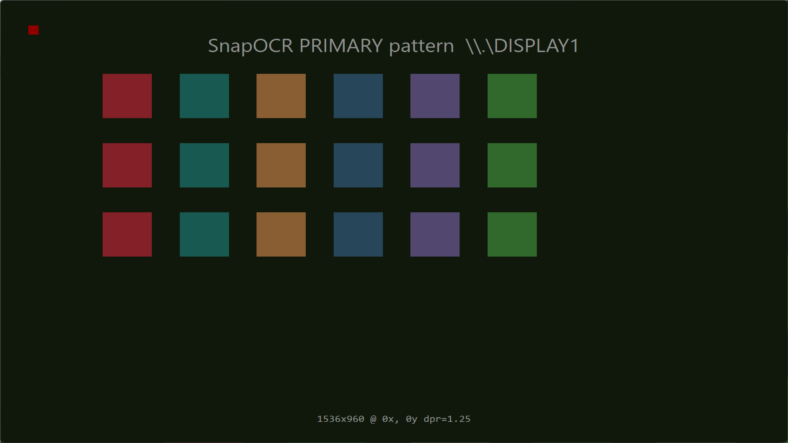
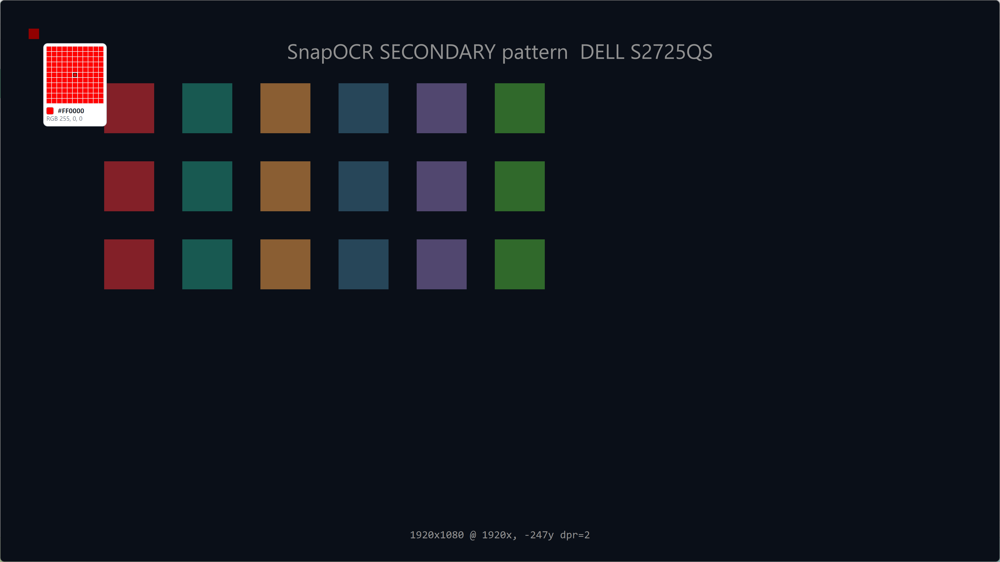

# SnapOCR 0.2.2（双屏 / 混合 DPI 修复版）

> 状态：正式版 — 修复双屏与混合 DPI 下的截图串屏、放大镜/取色坐标、窗口悬停与贴边提示问题，并新增多屏诊断工具。
> 发布日期：2026-11-02
> 下载：
> - 安装包：[SnapOCR-0.2.2-setup.exe](https://github.com/poluce/SnapOCR/releases/download/v0.2.2/SnapOCR-0.2.2-setup.exe)
> - 绿色包：[SnapOCR-0.2.2-win64.zip](https://github.com/poluce/SnapOCR/releases/download/v0.2.2/SnapOCR-0.2.2-win64.zip)

## 0.2.2 更新内容

0.2.2 集中处理多显示器与混合 DPI。两轮修复均在本机双屏实机验证：
主屏 `\\.\DISPLAY1` 1920×1200 @125%，副屏 DELL S2725QS 3840×2160 @200%（物理原点 1920, -247）。
测试版 v0.2.2-rc.1 / rc.2 只用于验证多屏修复，本正式版包含全部修复。

### 修复：副屏截图串屏

`MonitorLayout::enumerate()` 用 `displayName == deviceName` 判断“尚未匹配”。当设备名与 Qt 屏幕名恰好相同时，已配对的显示器被当成未匹配，再与另一块屏交换，覆盖层因此显示另一块屏的画面。现在配对状态用显式记录，名字 → 主屏 → 方位三级规则不变，并抽出纯函数 `detail::matchScreens` 补单测。

### 修复：放大镜、取色与窗口悬停

覆盖层绘制以本屏左上角为原点，但放大镜、取色、窗口悬停命中与高亮直接使用全局坐标。现在统一做全局 → 屏内逻辑/物理换算：副屏放大镜正常显示，中心格取到正确像素；悬停高亮按物理像素绘制，125% 屏不再偏大。

### 修复：跨屏残留与混合 DPI 细节

- 光标跨屏后清理上一块屏的放大镜与悬停高亮；
- OCR「贴边」提示改用物理虚拟桌面判断，混合 DPI 下不再漏报；
- 滚动长截图控制条改用 `MonitorLayout` + `physicalRectToGlobalLogical` 逐屏换算，副屏不再偏位。

### 首轮修复（0.2.2-rc.1 / rc.2 阶段）

- 每块屏用 `CreateDCW("\\.\DISPLAYn")` 从 (0,0) 捕获，失败回退屏幕 DC 并记录告警；
- 覆盖层先建原生句柄、`QWindow::setScreen(目标屏)`，显示后校正几何；
- 区域捕获（滚动长截图）按区域所在显示器的设备 DC 捕获。

### 新增：多屏诊断

- `--diagnose [目录]`：一键生成 `doctor.txt`、`capture.txt`、`dump.png`（整屏 + 每屏单独 PNG）；
- 发布包内置 `diagnose.bat`，双击即可生成诊断目录；
- `--doctor` 增加 `qtScreens` 列表，与 Win32 `monitors` 对照；
- `--capture-dump <文件>` 输出整屏与逐屏 PNG，并打印每块屏的物理/逻辑几何、DPR 与捕获结果。

## 已验证

| 项 | 结果 |
|----|------|
| 自动化测试 | `ctest` 40/40 通过（含新增 `test_monitor_layout`、副屏放大镜、混合 DPI 贴边、副屏物理→逻辑换算用例） |
| CI | Windows / MSVC / Qt 6.10.3：构建、ctest、原生冒烟、打包、安装包全部通过（run 41405736358，提交 3e3fb63） |
| 实机双屏配对 | `--doctor`：DISPLAY1 1920×1200 → 逻辑 1536×960 / dpr 1.25；DISPLAY2 3840×2160 → 逻辑 1920×1080 / dpr 2 |
| 逐屏捕获 | `--capture-selftest`：两块屏分别 1920×1200、3840×2160，虚拟桌面 5760×2160，逐屏 PNG 正确 |
| 交互验证 | 两块屏铺合成测试图，光标置于副屏红色取样点后按 F1：覆盖层出现在副屏、画面正确、放大镜中心格 `#FF0000` |
| 发布包独立运行 | 解压后 `--version` = SnapOCR 0.2.2；`--smoke-test` PASS；`--doctor` PASS；`--selftest-all` 4/4 PASS（smoke/capture/stability/perf） |
| 在线更新链路 | 0.2.1 包 `--check-update` → `latest: 0.2.2` + 安装包地址 + `UPDATE_AVAILABLE`；0.2.2 自身 → `UP_TO_DATE` |

修复前后对比（基线 `dd464cf`，修复后 `1edfe0c`）：

| 修复前：副屏显示主屏画面 | 修复后：副屏内容与放大镜取色正确 |
|---|---|
|  |  |

## 已知限制

- 屏幕旋转、RDP、显示器热插拔未验证；
- 其余限制同 0.2.1：未签名；RapidOCR（P1）未集成；IM 剪贴板兼容与干净 Windows 机器未验证；
- CI 使用 Qt 6.10.3，开发机为 Qt 6.11.1，源码保持 Qt 6.5+ 兼容。

## 升级方式

- 0.2.1 用户：启动后自动检查新版本（设置可关闭），或托盘菜单「检查更新」；也可直接下载本页安装包/绿色包；
- 安装包按当前用户安装到 `%LOCALAPPDATA%\Programs`，不需要管理员权限，桌面图标与开机自启可选；
- 绿色包解压到任意目录，双击 `SnapOCR.exe` 即可。

## 包内容与校验

| 资产 | 大小 | SHA-256 |
|------|------|---------|
| `SnapOCR-0.2.2-setup.exe` | 29,315,754 B | `31838015c38d75e42645e264a0fab03eace6e78867a61105d1d8618ad104928a` |
| `SnapOCR-0.2.2-win64.zip` | 31,870,283 B | `4270b24f3d01f0b89a4144988e2a72a174c1083c454fa228301cfe20283f2a0a` |

绿色包含 Qt 运行库、`translations/snapocr_en.qm`、`diagnose.bat`、`vc_redist.x64.exe`；
已裁掉 Widgets 用不到的 DirectX 着色器编译器（`dxcompiler.dll`/`dxil.dll`）。
